# Requirements Specification: Online Sales Management System

## Document Metadata & Team Allocation

- **Project Name:** Online Sales Management Desktop Application
- **Course:** VGU 61CSE215 Object-Oriented Programming in Java
- **Architecture:** 3-Tier Model-View-Controller (UI/UX $\rightarrow$ Controller $\rightarrow$ Database)
- **Currency:** Vietnamese Dong (VND, `java.math.BigDecimal`, 0 decimal places displayed e.g., `150,000 VND`)
- **Target Platform:** Desktop Java Swing (JDK 21), PostgreSQL 15+ (pure JDBC with `PreparedStatement`, no ORM)
- **Team Split & Ownership:**
  - **Member A (Database Tier):** Nguyen Duy Duc Trong — Owns `Database/` (PostgreSQL schema, `XxxRecord` records, `XxxDao` interfaces, `PgXxxDao` JDBC implementations, `schema.sql`, `seed.sql`, `docs/database.md`, `docs/access-control.md`)
  - **Member B (Controller Tier):** [Member B Name] — Owns `Controller/` (Domain entities, inheritance models, business rules, `XxxService` interfaces, `XxxServiceImpl` classes, `ControllerFactory`, `docs/requirements.md`, `docs/objects.md`, `docs/classes.md`, `docs/packages-interfaces.md`, `docs/access-control.md`)
  - **Member C (UI/UX Tier):** [Member C Name] — Owns `UI/UX/` (Swing `JFrame`, `JDialog`, `JPanel` views, table models, event listeners, `App` main launcher, `docs/screens.md`, `docs/access-control.md`)

---

## 1. Business Context & Shop Owner Statement

> *"I operate a retail shop in Vietnam that sells consumer electronics, apparel, and home lifestyle accessories. While we showcase goods on our website and social channels, all actual customer engagement, ordering, phone orders, and walk-in sales are handled directly by my shop staff.*
>
> *Until now, my employees recorded orders on spreadsheets and paper notepads. This caused severe operational chaos: stock levels fell out of sync, items were double-sold when already out of stock, customer order histories were lost, and at the end of the month we could never determine exact daily revenue or identify which products were actually profitable.*
>
> *I commissioned this Java desktop software so my staff have a single, robust desktop terminal to run the shop. Frontline staff must be able to quickly look up customers, check product availability, assemble orders into a cart, take payments (cash or bank/card transfer), and decrement stock in real time. As shop owner and administrator, I need to log in to manage product catalogs, update prices, monitor employees, view low-stock alerts before shelves empty out, and inspect daily sales revenue in VND.*
>
> *Because all financial numbers are in Vietnamese Dong, the system must never use floating-point types for currency—every price, subtotal, and tax amount must use `BigDecimal` with exact integer currency values displayed without decimals. Finally, data integrity is paramount: when an order is submitted, the cart items, order record, payment, and inventory deduction must happen in one single database transaction. If stock is insufficient or payment fails, nothing must be committed."*

---

## 2. User Roles and Permissions

The system enforces Role-Based Access Control (RBAC). Customers are **not** system users; they do not have login credentials or passwords. They exist strictly as domain and database entities (`Customer` / `CustomerRecord`) referenced by orders.

| Role Code | Role Name | Description | Authorised Operations |
|---|---|---|---|
| `ADMIN` | Administrator / Shop Owner | Total operational and managerial authority over the system. | - Manage staff accounts (create, view, update status, reset passwords).<br>- Manage product categories (create, update, deactivate).<br>- Full product catalog control (create, update details, adjust prices, deactivate, manual stock adjustment).<br>- Manage customer records (create, search, edit details).<br>- Create orders and process payments (Cash & Card).<br>- View, search, and update order statuses (`PENDING`, `PAID`, `SHIPPED`, `CANCELLED`).<br>- Access executive sales statistics (daily revenue reports, top-selling products, low-stock inventory warnings). |
| `SALES_STAFF` | Sales Staff / Clerk | Day-to-day point-of-sale and fulfillment operator. | - Authenticate (login and logout) with staff credentials.<br>- View and search product catalog and check current stock levels (read-only; cannot modify product price or deactivate products).<br>- Manage customer records (create new customer, search, update contact info).<br>- Assemble cart, create sales orders, process payments, and checkout.<br>- View order queue, inspect itemized order details, and transition order status (`PENDING` $\rightarrow$ `PAID` $\rightarrow$ `SHIPPED`, or `CANCELLED`).<br>- View low-stock warning list to flag replenishment needs to the owner (cannot view financial revenue reports). |

---

## 3. Use-Case Diagram

The following Mermaid diagram visualises actors on the left and the core business use-cases organised by operational domain.

```mermaid
flowchart LR
    subgraph Actors [System Actors]
        Admin["fa:fa-user-tie Administrator<br/>(Shop Owner)"]
        Staff["fa:fa-user Sales Staff<br/>(Shop Clerk)"]
    end

    subgraph S2_Auth [S2: Authentication & Staff]
        UC_Login(["F2.1: Staff Login"])
        UC_Logout(["F2.4: Staff Logout"])
        UC_ManageStaff(["F2.3: Manage Staff Accounts"])
    end

    subgraph S3_Catalog [S3: Catalog & Inventory]
        UC_ManageCategory(["F3.2: Manage Categories"])
        UC_ManageProduct(["F3.3/3.4: Create & Update Product"])
        UC_SearchProduct(["F3.5: Search & Filter Products"])
        UC_AdjustStock(["F3.6: Direct Stock Adjustment"])
    end

    subgraph S4_Customers [S4: Customer Management]
        UC_CreateCustomer(["F4.1: Register Customer"])
        UC_UpdateCustomer(["F4.2: Update Customer Info"])
        UC_SearchCustomer(["F4.3: Search Customers"])
        UC_ViewHistory(["F4.4: View Order History"])
    end

    subgraph S5_Orders [S5: Order Creation & Checkout]
        UC_AddToCart(["F5.2: Stage Items in Cart"])
        UC_SelectPayment(["F5.3: Select Payment (Cash/Card)"])
        UC_Checkout(["F5.4: Atomic Order Checkout"])
    end

    subgraph S6_Fulfillment [S6: Order Lifecycle]
        UC_ViewOrders(["F6.1/6.2: Search & Filter Orders"])
        UC_ViewDetail(["F6.3: View Order Receipt Details"])
        UC_UpdateStatus(["F6.4: Update Order Status"])
    end

    subgraph S7_Analytics [S7: Reports & Analytics]
        UC_DailyRevenue(["F7.1: View Daily Revenue"])
        UC_TopProducts(["F7.2: View Top-Selling Products"])
        UC_LowStock(["F7.3: View Low-Stock Alerts"])
    end

    %% Staff associations
    Staff --> UC_Login
    Staff --> UC_Logout
    Staff --> UC_SearchProduct
    Staff --> UC_CreateCustomer
    Staff --> UC_UpdateCustomer
    Staff --> UC_SearchCustomer
    Staff --> UC_ViewHistory
    Staff --> UC_AddToCart
    Staff --> UC_SelectPayment
    Staff --> UC_Checkout
    Staff --> UC_ViewOrders
    Staff --> UC_ViewDetail
    Staff --> UC_UpdateStatus
    Staff --> UC_LowStock

    %% Admin associations (inherits all Staff capabilities + administrative functions)
    Admin --> UC_Login
    Admin --> UC_Logout
    Admin --> UC_ManageStaff
    Admin --> UC_ManageCategory
    Admin --> UC_ManageProduct
    Admin --> UC_SearchProduct
    Admin --> UC_AdjustStock
    Admin --> UC_CreateCustomer
    Admin --> UC_UpdateCustomer
    Admin --> UC_SearchCustomer
    Admin --> UC_ViewHistory
    Admin --> UC_AddToCart
    Admin --> UC_SelectPayment
    Admin --> UC_Checkout
    Admin --> UC_ViewOrders
    Admin --> UC_ViewDetail
    Admin --> UC_UpdateStatus
    Admin --> UC_DailyRevenue
    Admin --> UC_TopProducts
    Admin --> UC_LowStock
```



---

## 4. Numbered Function List (Grouped by Build Slices S1–S7)

Every function specifies concrete inputs, outputs, business validation rules, and the target Swing screen.

```
Type Legend:
- ID: Integer (int / Integer)
- Text: String
- Money: java.math.BigDecimal (scale = 2 in storage, displayed with 0 decimals: #,##0 VND)
- Count/Quantity: Integer (non-negative)
- Timestamp: java.time.LocalDateTime
- Date: java.time.LocalDate
- Flag: Boolean
- Enums: Role (ADMIN, SALES_STAFF), OrderStatus (PENDING, PAID, SHIPPED, CANCELLED), PaymentType (CASH, CARD)
```

---

### Slice 1 (S1): Database Connection, Schema, and Seed Data

#### `F1.1`: Database Connection Configuration & Verification
- **Description:** Establish and verify the connection pool/manager to PostgreSQL using parameters from `db.properties` (`db.url`, `db.user`, `db.password`).
- **Inputs:** `configFile: String` (defaults to `/db.properties` on classpath).
- **Outputs:** `connectionStatus: Boolean`, `dbServerVersion: String`, or throws `DatabaseException`.
- **Business Rules:**
  1. Connection must enforce `autoCommit = true` for single reads and explicit `setAutoCommit(false)` for multi-step transactions.
  2. JDBC URLs must specify UTF-8 encoding and the `sales_db` database name.
  3. No plaintext passwords in git; `db.properties` is git-ignored and populated from a sample template.
- **Screen:** Headless startup / `LoginDialog` (shows error dialog if DB is offline).
- **Tier Responsibilities:**
  - `Database/`: `DatabaseConnection.java`, `db.properties`.
  - `Controller/`: `ControllerFactory` triggers connection verification on startup.
  - `UI/UX/`: `App.java` handles connection failure with a friendly modal error dialog.

#### `F1.2`: Database Schema Initialization
- **Description:** Execute DDL script (`db/schema.sql`) creating all required tables, primary keys, foreign keys, constraints, and indexes.
- **Inputs:** `schemaScriptPath: String` (`db/schema.sql`).
- **Outputs:** `tablesCreatedCount: Integer`, `isSuccess: Boolean`.
- **Business Rules:**
  1. Primary keys are `SERIAL` or `IDENTITY` integers.
  2. Money columns (`price`, `total_amount`, `amount_paid`, `discount`) must be `NUMERIC(15, 2)` and check `>= 0`.
  3. Stock quantities must be `INTEGER` and check `>= 0`.
  4. Foreign key cascades: restrict delete on active relationships (e.g. cannot delete a category containing products; cannot delete a customer with orders).
- **Screen:** Headless DB setup tool / JUnit test harness.
- **Tier Responsibilities:**
  - `Database/`: `schema.sql`, automated setup runner in `DbSetup.java`.

#### `F1.3`: Seed Data Provisioning
- **Description:** Populate initial baseline data from `db/seed.sql` including the default Admin account (`admin / admin123`), sales staff (`staff1 / staff123`), root product categories, sample products, and demo customers.
- **Inputs:** `seedScriptPath: String` (`db/seed.sql`).
- **Outputs:** `recordsInserted: Integer`, `isSuccess: Boolean`.
- **Business Rules:**
  1. Must be idempotent (e.g., using `ON CONFLICT DO NOTHING`).
  2. Passwords in seed data must be hashed (SHA-256 or BCrypt) or salted before production use.
- **Screen:** Headless test execution.
- **Tier Responsibilities:**
  - `Database/`: `seed.sql`.

---

### Slice 2 (S2): Staff Authentication & Role Management

#### `F2.1`: Staff Login Authentication
- **Description:** Authenticate a staff member against stored credentials and return their profile with role permissions.
- **Inputs:**
  - `username: String` (not null, 3–50 chars, trimmed)
  - `password: String` (not null, plain text from password field)
- **Outputs:**
  - `staff: Staff` (containing `staffId: Integer`, `username: String`, `fullName: String`, `email: String`, `phone: String`, `role: Role`, `active: Boolean`)
  - Throws `AuthenticationException` on invalid credentials or inactive account.
- **Business Rules:**
  1. Passwords must be hashed using SHA-256 with salt. Plain text passwords must never be stored or logged.
  2. If `active == false`, login is rejected with error: *"Account has been deactivated. Please contact the administrator."*
  3. Case-insensitive username matching.
- **Screen:** `LoginDialog`
- **Tier Responsibilities:**
  - `Database/`: `StaffDao.findByUsername(String username): Optional<StaffRecord>`.
  - `Controller/`: `AuthService.login(String username, String password): Staff`.
  - `UI/UX/`: `LoginDialog` captures input, calls `AuthService`, and passes `Staff` session to `MainWindow`.

#### `F2.2`: Session & Role Resolution
- **Description:** Retrieve currently logged-in user profile and evaluate UI capability access tokens (`isAdmin()`, `isSalesStaff()`).
- **Inputs:** None (reads singleton/context `UserSession`).
- **Outputs:** `currentStaff: Staff`, `role: Role`.
- **Business Rules:**
  1. UI menus and buttons (such as Staff Management, Category Management, Daily Revenue) are disabled or hidden if `role != Role.ADMIN`.
- **Screen:** `MainWindow`
- **Tier Responsibilities:**
  - `Controller/`: `UserSession` state holder in Controller tier.
  - `UI/UX/`: `MainWindow` adjusts visible tabs and menu items.

#### `F2.3`: Staff Account CRUD Management (Admin Only)
- **Description:** Create new staff accounts, update contact information, toggle active status, or reset passwords.
- **Inputs:**
  - Create: `username: String`, `password: String`, `fullName: String`, `email: String`, `phone: String`, `role: Role`
  - Update: `staffId: Integer`, `fullName: String`, `email: String`, `phone: String`, `role: Role`, `active: Boolean`
  - Password Reset: `staffId: Integer`, `newPassword: String`
- **Outputs:** `savedStaff: Staff`, `isSuccess: Boolean`.
- **Business Rules:**
  1. Only callers with `Role.ADMIN` may invoke this function.
  2. `username` must be unique across all staff.
  3. Admin cannot deactivate their own currently active account.
  4. Phone must be valid Vietnamese format (10 digits starting with `0`).
- **Screen:** `StaffManagementDialog`
- **Tier Responsibilities:**
  - `Database/`: `StaffDao.insert(StaffRecord)`, `StaffDao.update(StaffRecord)`, `StaffDao.findAll()`.
  - `Controller/`: `StaffService.createStaff(...)`, `StaffService.updateStaff(...)`, `StaffService.deactivateStaff(...)`.
  - `UI/UX/`: `StaffManagementDialog` with `JTable`, input forms, validation highlights.

#### `F2.4`: Staff Logout
- **Description:** Terminate the current session, clear user credentials from memory, close `MainWindow`, and re-open `LoginDialog`.
- **Inputs:** None.
- **Outputs:** `isLoggedOut: Boolean`.
- **Business Rules:**
  1. Open orders in the cart that have not been checked out are discarded with confirmation prompt.
- **Screen:** `MainWindow` (Menu: File $\rightarrow$ Logout).
- **Tier Responsibilities:**
  - `Controller/`: `AuthService.logout()`.
  - `UI/UX/`: Disposes `MainWindow`, instantiates new `LoginDialog`.

---

### Slice 3 (S3): Category and Product Catalog Management

#### `F3.1`: Category Listing
- **Description:** Retrieve all active categories for display in combo boxes, filter bars, and management tables.
- **Inputs:** None (or `includeInactive: Boolean`).
- **Outputs:** `categories: List<Category>` (each has `categoryId: Integer`, `name: String`, `description: String`, `active: Boolean`).
- **Business Rules:**
  1. Default listing returns only `active == true` sorted alphabetically by `name`.
- **Screen:** `ProductManagementPanel`, `CreateOrderDialog`, `CategoryDialog`.
- **Tier Responsibilities:**
  - `Database/`: `CategoryDao.findAll()`, `CategoryDao.findActive()`.
  - `Controller/`: `CatalogService.getAllCategories()`.
  - `UI/UX/`: `CategoryComboBoxModel`, category tree/table.

#### `F3.2`: Category Creation & Modification (Admin Only)
- **Description:** Add a new product category or update an existing category's name and description.
- **Inputs:** `categoryId: Integer` (null if new), `name: String` (not blank, 2–100 chars), `description: String` (optional, max 255 chars).
- **Outputs:** `savedCategory: Category`.
- **Business Rules:**
  1. `name` must be unique (case-insensitive).
  2. Deactivating a category is blocked if active products are assigned to it, unless products are reassigned first.
- **Screen:** `CategoryDialog`
- **Tier Responsibilities:**
  - `Database/`: `CategoryDao.insert(...)`, `CategoryDao.update(...)`.
  - `Controller/`: `CatalogService.saveCategory(Category)`.
  - `UI/UX/`: `CategoryDialog` modal form.

#### `F3.3`: Product Creation (Admin Only)
- **Description:** Register a new product into the catalog with price in VND and initial inventory quantity.
- **Inputs:**
  - `categoryId: Integer` (foreign key, required)
  - `name: String` (not blank, 2–150 chars)
  - `description: String` (optional)
  - `price: BigDecimal` (scale = 2, value >= 0 VND, integer unit)
  - `stockQuantity: Integer` (integer >= 0)
- **Outputs:** `createdProduct: Product` (contains assigned `productId: Integer`, `createdAt: LocalDateTime`, `active: Boolean = true`).
- **Business Rules:**
  1. Price must be strictly greater than 0 VND (`price.compareTo(BigDecimal.ZERO) > 0`).
  2. `stockQuantity` defaults to 0 if not specified; cannot be negative.
  3. Product names within the same category should be unique.
- **Screen:** `ProductEditDialog`
- **Tier Responsibilities:**
  - `Database/`: `ProductDao.insert(ProductRecord): ProductRecord`.
  - `Controller/`: `CatalogService.createProduct(Product): Product`.
  - `UI/UX/`: `ProductEditDialog` with category dropdown and formatted VND number field.

#### `F3.4`: Product Modification & Deactivation (Admin Only)
- **Description:** Update product title, category, price, description, or mark as inactive (soft delete).
- **Inputs:** `productId: Integer`, `categoryId: Integer`, `name: String`, `description: String`, `price: BigDecimal`, `active: Boolean`.
- **Outputs:** `updatedProduct: Product`.
- **Business Rules:**
  1. Hard deletes are forbidden to maintain foreign key integrity with past order items. Deactivation sets `active = false`.
  2. Price changes do not affect previously completed order items (past orders store the historical purchase price).
- **Screen:** `ProductEditDialog`
- **Tier Responsibilities:**
  - `Database/`: `ProductDao.update(ProductRecord)`.
  - `Controller/`: `CatalogService.updateProduct(Product)`.
  - `UI/UX/`: Edit button in `ProductManagementPanel`.

#### `F3.5`: Search & Filter Products (Staff & Admin)
- **Description:** Flexible multi-criteria search and filter across the product catalog. Overloaded methods support keyword search, category filter, price range, and stock availability.
- **Inputs (Overloaded in Service):**
  - Overload 1: `keyword: String` (matches product name or description, case-insensitive partial match)
  - Overload 2: `categoryId: Integer`
  - Overload 3: `minPrice: BigDecimal`, `maxPrice: BigDecimal`
  - Overload 4 (Combined): `keyword: String`, `categoryId: Integer`, `minPrice: BigDecimal`, `maxPrice: BigDecimal`, `onlyInStock: Boolean`
- **Outputs:** `products: List<Product>`
- **Business Rules:**
  1. If `onlyInStock == true`, filter adds condition `stock_quantity > 0`.
  2. Price bounds: if `minPrice != null && maxPrice != null`, verify `minPrice <= maxPrice`.
  3. For Sales Staff, only `active == true` products are shown. For Admin, inactive products can be toggled.
- **Screen:** `ProductManagementPanel`, `CreateOrderDialog` (Product picker table).
- **Tier Responsibilities:**
  - `Database/`: `ProductDao.search(String keyword, Integer categoryId, BigDecimal minPrice, BigDecimal maxPrice, Boolean inStockOnly)`.
  - `Controller/`: Overloaded methods on `CatalogService`:
    - `search(String keyword)`
    - `search(Integer categoryId)`
    - `search(BigDecimal minPrice, BigDecimal maxPrice)`
    - `search(String keyword, Integer categoryId, BigDecimal minPrice, BigDecimal maxPrice, boolean inStockOnly)`
  - `UI/UX/`: Search bar, category filter dropdown, price range sliders/text fields, and instant filter table model.

#### `F3.6`: Direct Stock Inventory Adjustment (Admin Only)
- **Description:** Manually increase or decrease inventory on hand to account for warehouse restocks, damaged goods, or inventory audits.
- **Inputs:** `productId: Integer`, `quantityDelta: Integer` (can be positive or negative), `reason: String` (e.g. "Restock shipment", "Damaged goods").
- **Outputs:** `newStockQuantity: Integer`, `updatedProduct: Product`.
- **Business Rules:**
  1. Resulting stock cannot be less than 0 (`currentStock + quantityDelta >= 0`).
  2. Operation is logged in console / system log.
- **Screen:** `StockAdjustmentDialog` (opened from `ProductManagementPanel`).
- **Tier Responsibilities:**
  - `Database/`: `ProductDao.updateStock(Integer productId, Integer newStock)`.
  - `Controller/`: `CatalogService.adjustStock(Integer productId, int quantityDelta, String reason)`.
  - `UI/UX/`: Stock adjustment button in `ProductManagementPanel`.

---

### Slice 4 (S4): Customer Management

#### `F4.1`: Customer Registration
- **Description:** Record a new customer profile into the database with contact and shipping details.
- **Inputs:**
  - `fullName: String` (not blank, 2–100 chars)
  - `phone: String` (not blank, 10 digits starting with `0`, unique)
  - `email: String` (optional, valid email regex if provided)
  - `address: String` (not blank, shipping destination, 5–255 chars)
- **Outputs:** `createdCustomer: Customer` (includes assigned `customerId: Integer`, `createdAt: LocalDateTime`).
- **Business Rules:**
  1. Phone number must be unique across all customers. If duplicate phone exists, system rejects creation and prompts staff to select existing customer.
  2. Customer is a record, not a login user; password fields do not exist.
  3. `fullName` and `phone` must be trimmed of surrounding whitespace.
- **Screen:** `CustomerEditDialog`, inline modal from `CreateOrderDialog`.
- **Tier Responsibilities:**
  - `Database/`: `CustomerDao.insert(CustomerRecord): CustomerRecord`.
  - `Controller/`: `CustomerService.registerCustomer(Customer): Customer`.
  - `UI/UX/`: Form inputs with real-time phone validation.

#### `F4.2`: Customer Details Modification
- **Description:** Update address, email, phone, or name for an existing customer.
- **Inputs:** `customerId: Integer`, `fullName: String`, `phone: String`, `email: String`, `address: String`.
- **Outputs:** `updatedCustomer: Customer`.
- **Business Rules:**
  1. If phone number is modified, check uniqueness against all other records (`phone == newPhone AND customer_id != this.id`).
- **Screen:** `CustomerEditDialog`
- **Tier Responsibilities:**
  - `Database/`: `CustomerDao.update(CustomerRecord)`.
  - `Controller/`: `CustomerService.updateCustomer(Customer)`.
  - `UI/UX/`: `CustomerManagementPanel` Edit action.

#### `F4.3`: Customer Search & Lookup
- **Description:** Search for customer records by phone number, full name, or email.
- **Inputs (Overloaded in Service):**
  - Overload 1: `keyword: String` (searches across name, phone, email)
  - Overload 2: `phone: String` (exact or prefix match on phone)
- **Outputs:** `customers: List<Customer>`
- **Business Rules:**
  1. Instant auto-complete / search on typing in the order creation screen.
  2. Results sorted by `fullName` ascending.
- **Screen:** `CustomerManagementPanel`, `CreateOrderDialog` (Customer picker).
- **Tier Responsibilities:**
  - `Database/`: `CustomerDao.search(String keyword)`, `CustomerDao.findByPhone(String phone)`.
  - `Controller/`: `CustomerService.search(String keyword)`, `CustomerService.findByPhone(String phone)`.
  - `UI/UX/`: Search text box with debounce listener triggering table refresh.

#### `F4.4`: Customer Order History Lookup
- **Description:** Retrieve list of all historical orders placed by a specific customer.
- **Inputs:** `customerId: Integer`.
- **Outputs:** `orders: List<Order>` (order ID, date, total amount, status, items summary).
- **Business Rules:**
  1. Sorted by `orderDate` descending.
- **Screen:** `CustomerHistoryDialog` (opened from `CustomerManagementPanel`).
- **Tier Responsibilities:**
  - `Database/`: `OrderDao.findByCustomerId(Integer customerId)`.
  - `Controller/`: `CustomerService.getOrderHistory(Integer customerId)`.
  - `UI/UX/`: `CustomerHistoryDialog` containing order summary table.

---

### Slice 5 (S5): Order Creation, Checkout & Payment Transaction

#### `F5.1`: Select Customer for Order Session
- **Description:** Associate an order in progress with an existing customer or quick-register a new customer without losing cart items.
- **Inputs:** `customerId: Integer` OR `newCustomerData: Customer`.
- **Outputs:** `activeCustomer: Customer`.
- **Business Rules:**
  1. Every order must be linked to exactly one customer. Anonymous/guest checkout requires creating a default or generic customer record (e.g., "Walk-in Customer / Khách lẻ").
- **Screen:** `CreateOrderDialog`
- **Tier Responsibilities:**
  - `Controller/`: `OrderSession.setCustomer(Customer)`.
  - `UI/UX/`: Customer selection box with "New Customer" quick-dialog button.

#### `F5.2`: Cart Item Staging & Real-Time Price Calculation
- **Description:** Add products to the cart, modify quantity, or remove items. Automatically calculates line total, cart subtotal, discount, and grand total in VND.
- **Inputs:**
  - Add/Modify: `productId: Integer`, `quantity: Integer`
  - Remove: `productId: Integer`
  - Discount: `discountAmount: BigDecimal` (defaults to `0 VND`)
- **Outputs:** `cart: Cart` (containing `items: List<CartItem>`, `subtotal: BigDecimal`, `discount: BigDecimal`, `totalAmount: BigDecimal`).
- **Business Rules:**
  1. Quantity requested must not exceed current product `stockQuantity`. If staff attempts to add 5 items when only 3 are in stock, reject with alert: *"Cannot add 5 units. Only 3 units available in stock."*
  2. Line item price is snapshotted from `Product.getPrice()`.
  3. Subtotal formula: $\text{Subtotal} = \sum (\text{item.unitPrice} \times \text{item.quantity})$.
  4. Grand total formula: $\text{TotalAmount} = \max(0, \text{Subtotal} - \text{Discount})$.
  5. All monetary calculations use `BigDecimal` with `RoundingMode.HALF_UP` (though in VND amounts are integer, scale 2 is preserved internally).
- **Screen:** `CreateOrderDialog` (Cart table).
- **Tier Responsibilities:**
  - `Controller/`: `Cart.java`, `CartItem.java` domain classes in `vgu.sales.controller.model`.
  - `UI/UX/`: `CreateOrderDialog` dynamic cart table with quantity spinners.

#### `F5.3`: Payment Method Selection & Validation (Polymorphic Model)
- **Description:** Specify how the order is paid using the polymorphic `Payment` hierarchy (`CashPayment` or `CardPayment`).
- **Inputs:**
  - Case A (Cash): `paymentType = CASH`, `amountGiven: BigDecimal`, `amountDue: BigDecimal`
  - Case B (Card/Bank Transfer): `paymentType = CARD`, `cardHolderName: String`, `transactionReference: String`, `bankName: String`, `amount: BigDecimal`
- **Outputs:** `payment: Payment` (polymorphic instance: `CashPayment` with `changeReturned = amountGiven - amountDue`, or `CardPayment` with authorization details).
- **Business Rules:**
  1. For `CashPayment`: `amountGiven >= amountDue`. Change returned = `amountGiven - amountDue`.
  2. For `CardPayment`: `cardHolderName` (min 2 chars) and `transactionReference` (bank trace number, min 4 chars) are mandatory.
  3. Abstract method `payment.processPayment()` executes specific validation.
- **Screen:** `PaymentDialog` (sub-dialog of `CreateOrderDialog`).
- **Tier Responsibilities:**
  - `Controller/`: Abstract class `Payment`, concrete subclasses `CashPayment` and `CardPayment`.
  - `UI/UX/`: Tabbed or card layout in `PaymentDialog` switching between Cash and Card form fields.

#### `F5.4`: Atomic Order Checkout & Stock Decrement Transaction
- **Description:** Persist order, insert all line items, record payment, and decrement product stock levels in a **single database transaction** (`setAutoCommit(false)` $\rightarrow$ `commit()` / `rollback()`).
- **Inputs:**
  - `customerId: Integer`
  - `staffId: Integer` (logged-in clerk)
  - `cartItems: List<CartItem>` (each with `productId: Integer`, `quantity: Integer`, `unitPrice: BigDecimal`)
  - `totalAmount: BigDecimal`
  - `payment: Payment`
  - `shippingAddress: String`
  - `notes: String` (optional)
- **Outputs:**
  - `completedOrder: Order` (assigned `orderId: Integer`, `orderCode: String` e.g. `ORD-20261020-001`, `orderDate: LocalDateTime`, `status: OrderStatus = PAID`).
  - Throws `InsufficientStockException`, `PaymentValidationException`, or `TransactionException`.
- **Business Rules:**
  1. **Strict Atomicity:** All four steps must succeed together:
     - Step 1: Lock and check stock for all items (`SELECT stock_quantity FROM products WHERE product_id = ? FOR UPDATE`).
     - Step 2: Decrement stock: `UPDATE products SET stock_quantity = stock_quantity - ? WHERE product_id = ?`. If any item goes below 0, roll back immediately!
     - Step 3: Insert record into `orders` table returning `order_id`.
     - Step 4: Batch insert line items into `order_items` table.
     - Step 5: Insert payment record into `payments` table linking to `order_id`.
  2. If any step throws an error, invoke `connection.rollback()` and propagate friendly error to UI.
  3. Status of newly paid order defaults to `OrderStatus.PAID` (or `OrderStatus.PENDING` if cash on delivery is recorded without full payment).
- **Screen:** `CreateOrderDialog` $\rightarrow$ triggers invoice preview / receipt dialog `OrderReceiptDialog`.
- **Tier Responsibilities:**
  - `Database/`: `OrderDao.createOrderWithTransaction(OrderRecord, List<OrderItemRecord>, PaymentRecord)`.
  - `Controller/`: `OrderService.checkout(Order): Order`.
  - `UI/UX/`: Progress indicator, success confirmation dialog with option to view/print receipt.

---

### Slice 6 (S6): Order Management, Search, and Status Lifecycle

#### `F6.1`: Order List Retrieval
- **Description:** Retrieve paginated or scrollable list of recent orders sorted by creation timestamp descending.
- **Inputs:** `limit: Integer` (e.g. 50), `offset: Integer` (e.g. 0).
- **Outputs:** `orders: List<OrderSummary>` (each with `orderId: Integer`, `orderCode: String`, `customerName: String`, `orderDate: LocalDateTime`, `totalAmount: BigDecimal`, `status: OrderStatus`, `itemCount: Integer`).
- **Business Rules:**
  1. Default sort is `orderDate DESC`.
  2. Order total formatted as VND (`#,##0 VND`).
- **Screen:** `OrderManagementPanel`
- **Tier Responsibilities:**
  - `Database/`: `OrderDao.findAll(int limit, int offset)`.
  - `Controller/`: `OrderService.getRecentOrders(int limit, int offset)`.
  - `UI/UX/`: `OrderManagementPanel` main `JTable`.

#### `F6.2`: Multi-Criteria Order Search and Filtering
- **Description:** Filter orders by status, date range, customer name/phone, or specific order code.
- **Inputs (Overloaded in Service):**
  - Overload 1: `status: OrderStatus`
  - Overload 2: `fromDate: LocalDate`, `toDate: LocalDate`
  - Overload 3: `searchKeyword: String` (matches order code or customer phone/name)
  - Overload 4 (Combined): `status: OrderStatus`, `fromDate: LocalDate`, `toDate: LocalDate`, `searchKeyword: String`
- **Outputs:** `orders: List<OrderSummary>`
- **Business Rules:**
  1. If `fromDate` and `toDate` are provided, verify `fromDate <= toDate`.
- **Screen:** `OrderManagementPanel`
- **Tier Responsibilities:**
  - `Database/`: `OrderDao.search(OrderStatus status, LocalDate fromDate, LocalDate toDate, String keyword)`.
  - `Controller/`: Overloaded `OrderService.searchOrders(...)`.
  - `UI/UX/`: Status filter dropdown, date pickers, search field with search button.

#### `F6.3`: Order Details & Itemized View
- **Description:** Retrieve the complete details of an order, including customer info, handling staff name, payment details, and itemized product list.
- **Inputs:** `orderId: Integer`.
- **Outputs:** `orderDetails: Order` (full graph: `Customer`, `Staff`, `List<OrderItem>`, `Payment`).
- **Business Rules:**
  1. Displays item unit price at time of purchase, line quantity, line total, payment reference, and current lifecycle status.
- **Screen:** `OrderDetailDialog`
- **Tier Responsibilities:**
  - `Database/`: `OrderDao.findById(Integer orderId)`, `OrderItemDao.findByOrderId(Integer orderId)`, `PaymentDao.findByOrderId(Integer orderId)`.
  - `Controller/`: `OrderService.getOrderDetails(Integer orderId): Order`.
  - `UI/UX/`: `OrderDetailDialog` with formatted printable receipt layout.

#### `F6.4`: Order Status Transition Lifecycle & Stock Reversal
- **Description:** Advance or cancel an order along its valid lifecycle paths:
  - `PENDING` $\rightarrow$ `PAID` $\rightarrow$ `SHIPPED`
  - Any state prior to `SHIPPED` $\rightarrow$ `CANCELLED`
- **Inputs:** `orderId: Integer`, `newStatus: OrderStatus`, `reason: String` (required if `CANCELLED`).
- **Outputs:** `updatedOrder: Order`, `isSuccess: Boolean`.
- **Business Rules:**
  1. **Valid State Transitions:**
     - `PENDING` can transition to `PAID` or `CANCELLED`.
     - `PAID` can transition to `SHIPPED` or `CANCELLED`.
     - `SHIPPED` is terminal (cannot be cancelled directly; requires return procedure out of scope).
     - `CANCELLED` is terminal.
  2. **Inventory Rollback on Cancellation:** If an order in `PENDING` or `PAID` status is marked `CANCELLED`, the system **must automatically replenish the product stock** in the same transaction:
     ```sql
     UPDATE products SET stock_quantity = stock_quantity + item.quantity WHERE product_id = item.product_id;
     ```
  3. Non-admin staff cannot cancel an order that has already been `PAID` without admin confirmation.
- **Screen:** `OrderDetailDialog`, `OrderManagementPanel` (Context action menu).
- **Tier Responsibilities:**
  - `Database/`: `OrderDao.updateStatusWithStockRollback(Integer orderId, OrderStatus status)`.
  - `Controller/`: `OrderService.updateOrderStatus(Integer orderId, OrderStatus newStatus, String reason)`.
  - `UI/UX/`: Status change dropdown with confirmation prompt for cancellation.

---

### Slice 7 (S7): Sales Reporting & Inventory Analytics

#### `F7.1`: Daily Revenue Report (Admin Only)
- **Description:** Generate daily aggregate revenue, total orders placed, and average order value for a given date range.
- **Inputs:** `startDate: LocalDate`, `endDate: LocalDate`.
- **Outputs:** `List<DailyRevenueRecord>`:
  - `date: LocalDate`
  - `orderCount: Integer`
  - `totalRevenue: BigDecimal` (VND, sum of paid/shipped orders)
  - `averageOrderValue: BigDecimal` (VND)
- **Business Rules:**
  1. Only orders with status `PAID` or `SHIPPED` are included in revenue calculations. `CANCELLED` orders are strictly excluded ($0 revenue).
  2. If `startDate > endDate`, reject with validation error.
  3. Accessible exclusively by `Role.ADMIN`.
- **Screen:** `StatisticsPanel` (Daily Revenue Tab).
- **Tier Responsibilities:**
  - `Database/`: `ReportDao.getDailyRevenue(LocalDate start, LocalDate end)`.
  - `Controller/`: `ReportService.getDailyRevenue(LocalDate start, LocalDate end)`.
  - `UI/UX/`: Date pickers, summary metrics cards (Total Revenue, Total Orders), and revenue summary `JTable`.

#### `F7.2`: Top-Selling Products Report (Admin Only)
- **Description:** Rank products by volume sold and total revenue generated within a specified time window.
- **Inputs:** `startDate: LocalDate`, `endDate: LocalDate`, `topN: Integer` (defaults to 10).
- **Outputs:** `List<TopProductRecord>`:
  - `productId: Integer`
  - `productName: String`
  - `categoryName: String`
  - `quantitySold: Integer`
  - `totalRevenue: BigDecimal` (VND)
- **Business Rules:**
  1. Considers line items from non-cancelled orders between `startDate 00:00:00` and `endDate 23:59:59`.
  2. Sorted by `quantitySold DESC`.
- **Screen:** `StatisticsPanel` (Top Products Tab).
- **Tier Responsibilities:**
  - `Database/`: `ReportDao.getTopSellingProducts(LocalDate start, LocalDate end, int limit)`.
  - `Controller/`: `ReportService.getTopProducts(LocalDate start, LocalDate end, int limit)`.
  - `UI/UX/`: Leaderboard table with rank badges.

#### `F7.3`: Low-Stock Inventory Warning Report (Staff & Admin)
- **Description:** Identify all active products whose current stock level is at or below a defined replenishment threshold.
- **Inputs:** `threshold: Integer` (defaults to 5 units).
- **Outputs:** `List<LowStockRecord>`:
  - `productId: Integer`
  - `productName: String`
  - `categoryName: String`
  - `currentStock: Integer`
  - `price: BigDecimal` (VND)
  - `reorderStatus: String` (e.g., "OUT OF STOCK" if 0, "LOW STOCK" if $\le$ threshold)
- **Business Rules:**
  1. Returns all active products where `stock_quantity <= threshold`.
  2. Sorted by `stock_quantity ASC` (out-of-stock items appear first).
  3. Both Admin and Sales Staff can view this report so clerks can alert the owner when stock is depleted.
- **Screen:** `StatisticsPanel` (Low-Stock Tab), warning badge on `MainWindow` status bar.
- **Tier Responsibilities:**
  - `Database/`: `ProductDao.findLowStock(int threshold)`.
  - `Controller/`: `CatalogService.getLowStockProducts(int threshold)`.
  - `UI/UX/`: Highlighted table rows (red for 0 stock, yellow for $\le$ threshold).

---

## 5. Screen List

This catalog specifies all user interfaces in the desktop application. This table serves as the foundational design contract for `UI/UX/docs/screens.md`.

| Screen ID | Screen / Component Name | Window Type | Purpose & Core Capabilities | Opened From | Allowed Roles |
|---|---|---|---|---|---|
| `SCR-01` | `LoginDialog` | `JDialog` (Modal) | Staff credential entry (`username`, masked `password`). Connects to database, authenticates, and initializes user session. | Application Startup (`App.main`) / Re-opened upon Logout | All (`ADMIN`, `SALES_STAFF`) |
| `SCR-02` | `MainWindow` | `JFrame` (Main Window) | Master container holding the top menu bar, navigation tabs, user session info header, and bottom status bar. | `LoginDialog` (on successful authentication) | All (`ADMIN`, `SALES_STAFF` with role-based tab masking) |
| `SCR-03` | `ProductManagementPanel` | `JPanel` (Tab in `MainWindow`) | Browse product catalog with search bar, category filter, price filter, stock counters, product table. Admin sees "Add Product", "Edit", "Adjust Stock", "Deactivate". | `MainWindow` ("Products" Tab) | All (Staff: view/search; Admin: full CRUD) |
| `SCR-04` | `ProductEditDialog` | `JDialog` (Modal) | Form to create a new product or modify an existing product (name, category dropdown, price in VND, description). | `ProductManagementPanel` ("Add" or "Edit" button) | `ADMIN` only |
| `SCR-05` | `CategoryDialog` | `JDialog` (Modal) | Manage product categories (list, create new, edit name/description, deactivate). | `MainWindow` (Menu: Management $\rightarrow$ Categories) | `ADMIN` only |
| `SCR-06` | `StockAdjustmentDialog` | `JDialog` (Modal) | Quick adjustment of inventory units (delta addition/subtraction with audit note). | `ProductManagementPanel` ("Adjust Stock" button) | `ADMIN` only |
| `SCR-07` | `CustomerManagementPanel` | `JPanel` (Tab in `MainWindow`) | Customer directory table, search by name/phone/email, button to register new customer, edit details, or view order history. | `MainWindow` ("Customers" Tab) | All (`ADMIN`, `SALES_STAFF`) |
| `SCR-08` | `CustomerEditDialog` | `JDialog` (Modal) | Form to register a new customer or update existing details (name, phone, email, delivery address). | `CustomerManagementPanel` OR `CreateOrderDialog` ("+ New" button) | All (`ADMIN`, `SALES_STAFF`) |
| `SCR-09` | `CustomerHistoryDialog` | `JDialog` (Modal) | Displays order history table for a selected customer with date, order total, status, and view receipt action. | `CustomerManagementPanel` ("View History" button) | All (`ADMIN`, `SALES_STAFF`) |
| `SCR-10` | `CreateOrderDialog` | `JDialog` (Modal/Full) | Point-of-sale checkout workspace: customer selector, product search & add-to-cart, cart table with quantity spinners, subtotal/discount calculations, and checkout trigger. | `MainWindow` ("New Order" button in header or Orders tab) | All (`ADMIN`, `SALES_STAFF`) |
| `SCR-11` | `PaymentDialog` | `JDialog` (Modal) | Polymorphic payment collector: select Cash (enter given money, calculate change) or Card/Transfer (enter bank trace ref, cardholder name). | `CreateOrderDialog` ("Proceed to Payment" button) | All (`ADMIN`, `SALES_STAFF`) |
| `SCR-12` | `OrderReceiptDialog` | `JDialog` (Modal) | Visual receipt invoice displaying order code, customer info, clerk name, itemized table, payment method, and formatted VND totals. | `CreateOrderDialog` (post-checkout) OR `OrderManagementPanel` ("View Details") | All (`ADMIN`, `SALES_STAFF`) |
| `SCR-13` | `OrderManagementPanel` | `JPanel` (Tab in `MainWindow`) | Browse order queue, multi-filter by status, date range, customer name/code. Context actions: view detail receipt, advance status (`PAID` $\rightarrow$ `SHIPPED`), cancel order. | `MainWindow` ("Orders" Tab) | All (`ADMIN`, `SALES_STAFF`) |
| `SCR-14` | `StatisticsPanel` | `JPanel` (Tab in `MainWindow`) | Analytical dashboard with three sub-views: (1) Daily Revenue Summary table & totals, (2) Top 10 Selling Products leaderboard, (3) Low-Stock Alerts table. | `MainWindow` ("Statistics" Tab) | Revenue/Top: `ADMIN` only; Low-Stock: All |
| `SCR-15` | `StaffManagementDialog` | `JDialog` (Modal) | Manage employee user accounts: list staff, register new employee, assign `Role` (`ADMIN` or `SALES_STAFF`), toggle active status, reset password. | `MainWindow` (Menu: Management $\rightarrow$ Staff Accounts) | `ADMIN` only |

---

## 6. Out of Scope

To ensure realistic delivery within the course timeline and strict adherence to the project architectural rules, the following features are explicitly **out of scope**:

1. **Public Web Storefront / E-Commerce Portal:**
   - There is no public website, customer login portal, or mobile app for end-consumers. Customers do not log into the system. All operations are performed by shop staff via the Java Swing desktop client.
2. **Real-Time Payment Gateway Hardware / API Integration:**
   - No live network integration with payment aggregators (e.g., VNPay, MoMo, ZaloPay, Stripe) or physical POS chip terminal drivers. Payment processing is recorded manually by staff as either cash received or bank transfer reference code verification.
3. **Multi-Warehouse & Automated Logistics Carrier APIs:**
   - The application manages a single physical store inventory. Real-time courier API synchronization (e.g., GHN, GHTK, ViettelPost) is excluded; shipping status is updated manually by staff.
4. **Hardware Driver Integration (Thermal Receipt Printers / Barcode Scanners):**
   - No raw ESC/POS printer driver integration. Invoices are previewed on screen (`OrderReceiptDialog`) and printed using standard Java Swing `Printable` graphics if desired. Barcode readers operating as standard USB HID keyboard wedges are naturally supported via text fields.
5. **Multi-Currency Conversion:**
   - Currency is exclusively Vietnamese Dong (VND). Foreign currency conversion (USD, EUR) is not supported.

---

## 7. Parallel Work Split for the 3 Tiers

Each slice S1–S7 has been specified with concrete data boundaries to enable parallel implementation:

- **Member A (`Database/`):** Implements tables in `schema.sql`, default data in `seed.sql`, records (`XxxRecord`), DAO interfaces (`XxxDao`), and JDBC implementations (`PgXxxDao`) with `PreparedStatement`.
- **Member B (`Controller/`):** Implements domain models (`Person`, `Staff`, `Customer`, `Product`, `Category`, `Order`, `OrderItem`, `Payment`, `CashPayment`, `CardPayment`), services (`XxxService`, `XxxServiceImpl`), validations, and `ControllerFactory`.
- **Member C (`UI/UX/`):** Implements Swing components (`JFrame`, `JDialog`, `JPanel`), table models, dialogs, input validation UX, and integration with `ControllerFactory`.
