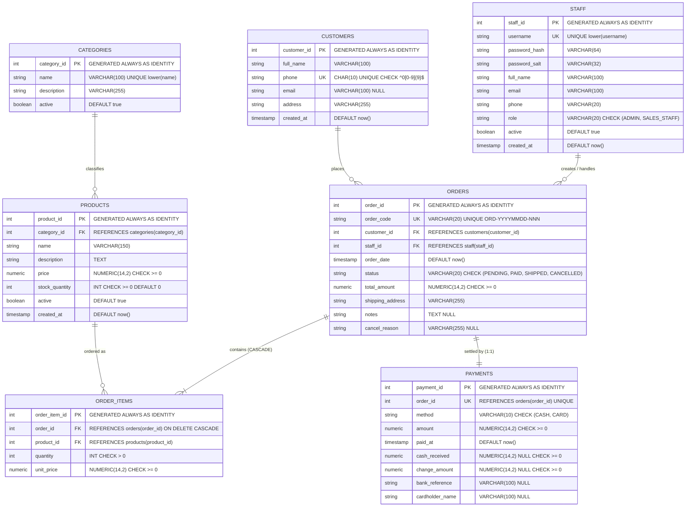

# Database Tier Architecture & Design Specification (Report Section VIII.3)

**Author:** Nguyen Duy Duc Trong (Member A — Database Tier Lead)  
**System:** Online Sales Management Desktop Application  
**Course:** VGU 61CSE215 Object-Oriented Programming in Java  
**Target RDBMS:** PostgreSQL 16+ (Pure JDBC, `PreparedStatement`, No ORM)  
**Java Version:** JDK 21  

---

## 1. Entity-Relationship Diagram (ERD)

The database schema models an e-commerce retail store operating in Vietnam. The 7 core tables enforce strict referential integrity, identity primary keys, domain-specific `CHECK` constraints, and audit timestamps.



---

## 2. Table Specifications

### 2.1 Table: `staff`
Stores administrative and sales clerk credentials with salted SHA-256 password digests.

| Column | PostgreSQL Type | Nullable | Default | Constraints | Description / Meaning |
|---|---|---|---|---|---|
| `staff_id` | `INTEGER` | `NOT NULL` | `IDENTITY` | `PRIMARY KEY` | Unique synthetic identifier for staff member |
| `username` | `VARCHAR(50)` | `NOT NULL` | — | `UNIQUE` | Case-insensitive login handle (lowercase enforced) |
| `password_hash` | `VARCHAR(64)` | `NOT NULL` | — | — | 64-character SHA-256 hexadecimal password digest |
| `password_salt` | `VARCHAR(32)` | `NOT NULL` | — | — | 32-character random cryptographic hex salt |
| `full_name` | `VARCHAR(100)` | `NOT NULL` | — | — | Legal full name of employee |
| `email` | `VARCHAR(100)` | `NOT NULL` | — | — | Staff organizational email address |
| `phone` | `VARCHAR(20)` | `NOT NULL` | — | — | Contact telephone number |
| `role` | `VARCHAR(20)` | `NOT NULL` | — | `CHECK (role IN ('ADMIN', 'SALES_STAFF'))` | Authorization role boundary |
| `active` | `BOOLEAN` | `NOT NULL` | `true` | — | Soft-delete flag; inactive accounts cannot log in |
| `created_at` | `TIMESTAMP` | `NOT NULL` | `now()` | — | Audit timestamp of account creation |

- **Indexes:**
  - `idx_staff_lower_username`: `UNIQUE INDEX ON staff (lower(username))`

---

### 2.2 Table: `categories`
Product categorization taxonomy.

| Column | PostgreSQL Type | Nullable | Default | Constraints | Description / Meaning |
|---|---|---|---|---|---|
| `category_id` | `INTEGER` | `NOT NULL` | `IDENTITY` | `PRIMARY KEY` | Unique category identifier |
| `name` | `VARCHAR(100)` | `NOT NULL` | — | — | Display title of category |
| `description` | `VARCHAR(255)` | `NULL` | — | — | Explanatory note or scope of category |
| `active` | `BOOLEAN` | `NOT NULL` | `true` | — | Soft-delete status flag |

- **Indexes:**
  - `idx_categories_lower_name`: `UNIQUE INDEX ON categories (lower(name))`

---

### 2.3 Table: `products`
Merchandise inventory catalog.

| Column | PostgreSQL Type | Nullable | Default | Constraints | Description / Meaning |
|---|---|---|---|---|---|
| `product_id` | `INTEGER` | `NOT NULL` | `IDENTITY` | `PRIMARY KEY` | Unique product stock keeping identifier |
| `category_id` | `INTEGER` | `NOT NULL` | — | `REFERENCES categories(category_id)` | Classification foreign key |
| `name` | `VARCHAR(150)` | `NOT NULL` | — | — | Commercial product title |
| `description` | `TEXT` | `NULL` | — | — | Technical specs and marketing overview |
| `price` | `NUMERIC(14,2)` | `NOT NULL` | — | `CHECK (price >= 0)` | Standard catalog unit price in VND |
| `stock_quantity` | `INTEGER` | `NOT NULL` | `0` | `CHECK (stock_quantity >= 0)` | Available physical stock units |
| `active` | `BOOLEAN` | `NOT NULL` | `true` | — | Soft-delete flag (inactive hides from catalog) |
| `created_at` | `TIMESTAMP` | `NOT NULL` | `now()` | — | Date and time listed |

- **Table Constraints:**
  - `CONSTRAINT uq_products_category_name UNIQUE (category_id, name)`
- **Indexes:**
  - `idx_products_category_id`: `INDEX ON products (category_id)`
  - `idx_products_lower_name`: `INDEX ON products (lower(name))`

---

### 2.4 Table: `customers`
Customer contact registry.

| Column | PostgreSQL Type | Nullable | Default | Constraints | Description / Meaning |
|---|---|---|---|---|---|
| `customer_id` | `INTEGER` | `NOT NULL` | `IDENTITY` | `PRIMARY KEY` | Unique customer identity number |
| `full_name` | `VARCHAR(100)` | `NOT NULL` | — | — | Customer complete name |
| `phone` | `CHAR(10)` | `NOT NULL` | — | `UNIQUE, CHECK (phone ~ '^0[0-9]{9}$')` | 10-digit VN phone number starting with '0' |
| `email` | `VARCHAR(100)` | `NULL` | — | — | Optional contact email address |
| `address` | `VARCHAR(255)` | `NOT NULL` | — | — | Default residential or shipping destination |
| `created_at` | `TIMESTAMP` | `NOT NULL` | `now()` | — | Record creation timestamp |

- **Indexes:**
  - `idx_customers_lower_full_name`: `INDEX ON customers (lower(full_name))`

---

### 2.5 Table: `orders`
Sales order header recording customer, sales clerk, total monetary sum, and delivery state.

| Column | PostgreSQL Type | Nullable | Default | Constraints | Description / Meaning |
|---|---|---|---|---|---|
| `order_id` | `INTEGER` | `NOT NULL` | `IDENTITY` | `PRIMARY KEY` | Unique internal order identity |
| `order_code` | `VARCHAR(20)` | `NOT NULL` | — | `UNIQUE` | Business human-readable code `ORD-YYYYMMDD-NNN` |
| `customer_id` | `INTEGER` | `NOT NULL` | — | `REFERENCES customers(customer_id)` | Purchasing customer reference |
| `staff_id` | `INTEGER` | `NOT NULL` | — | `REFERENCES staff(staff_id)` | Handling employee reference |
| `order_date` | `TIMESTAMP` | `NOT NULL` | `now()` | — | Exact placement timestamp |
| `status` | `VARCHAR(20)` | `NOT NULL` | — | `CHECK (status IN ('PENDING', 'PAID', 'SHIPPED', 'CANCELLED'))` | Order lifecycle state |
| `total_amount` | `NUMERIC(14,2)` | `NOT NULL` | — | `CHECK (total_amount >= 0)` | Aggregated total price of all order items |
| `shipping_address` | `VARCHAR(255)` | `NOT NULL` | — | — | Target physical shipping location |
| `notes` | `TEXT` | `NULL` | — | — | Customer requests or internal handling remarks |
| `cancel_reason` | `VARCHAR(255)` | `NULL` | — | — | Mandatory justification if status is CANCELLED |

- **Indexes:**
  - `idx_orders_customer_id`: `INDEX ON orders (customer_id)`
  - `idx_orders_order_date`: `INDEX ON orders (order_date)`
  - `idx_orders_status`: `INDEX ON orders (status)`

---

### 2.6 Table: `order_items`
Snapshot line items purchased within an order.

| Column | PostgreSQL Type | Nullable | Default | Constraints | Description / Meaning |
|---|---|---|---|---|---|
| `order_item_id` | `INTEGER` | `NOT NULL` | `IDENTITY` | `PRIMARY KEY` | Line item unique row identity |
| `order_id` | `INTEGER` | `NOT NULL` | — | `REFERENCES orders(order_id) ON DELETE CASCADE` | Parent order reference (cascaded on delete) |
| `product_id` | `INTEGER` | `NOT NULL` | — | `REFERENCES products(product_id)` | Purchased catalog product reference |
| `quantity` | `INTEGER` | `NOT NULL` | — | `CHECK (quantity > 0)` | Number of units purchased |
| `unit_price` | `NUMERIC(14,2)` | `NOT NULL` | — | `CHECK (unit_price >= 0)` | Historical unit price snapshot at checkout time |

- **Table Constraints:**
  - `CONSTRAINT uq_order_items_order_product UNIQUE (order_id, product_id)`
- **Indexes:**
  - `idx_order_items_product_id`: `INDEX ON order_items (product_id)`

---

### 2.7 Table: `payments`
Monetary settlement record attached 1:1 to an order.

| Column | PostgreSQL Type | Nullable | Default | Constraints | Description / Meaning |
|---|---|---|---|---|---|
| `payment_id` | `INTEGER` | `NOT NULL` | `IDENTITY` | `PRIMARY KEY` | Payment unique row identity |
| `order_id` | `INTEGER` | `NOT NULL` | — | `REFERENCES orders(order_id) UNIQUE` | Settled order (1:1 relationship) |
| `method` | `VARCHAR(10)` | `NOT NULL` | — | `CHECK (method IN ('CASH', 'CARD'))` | Payment method discriminator |
| `amount` | `NUMERIC(14,2)` | `NOT NULL` | — | `CHECK (amount >= 0)` | Net settled amount (must equal order total) |
| `paid_at` | `TIMESTAMP` | `NOT NULL` | `now()` | — | Exact settlement timestamp |
| `cash_received` | `NUMERIC(14,2)` | `NULL` | — | `CHECK (cash_received >= 0)` | Physical cash tendered by customer (CASH only) |
| `change_amount` | `NUMERIC(14,2)` | `NULL` | — | `CHECK (change_amount >= 0)` | Change refunded to customer (CASH only) |
| `bank_reference` | `VARCHAR(100)` | `NULL` | — | — | External bank trace / transaction ID (CARD only) |
| `cardholder_name`| `VARCHAR(100)` | `NULL` | — | — | Legal cardholder / account owner name (CARD only) |

- **Table Constraints (Polymorphic Method Integrity):**
  - `CONSTRAINT chk_payments_cash CHECK (method != 'CASH' OR (cash_received IS NOT NULL AND change_amount IS NOT NULL AND cash_received >= amount AND change_amount = cash_received - amount AND bank_reference IS NULL AND cardholder_name IS NULL))`
  - `CONSTRAINT chk_payments_card CHECK (method != 'CARD' OR (bank_reference IS NOT NULL AND cardholder_name IS NOT NULL AND cash_received IS NULL AND change_amount IS NULL))`

---

## 3. Java Contract for Package `vgu.sales.database`

The Database tier defines immutable data carrier records, generic DAO patterns, specialized DAO interfaces, and domain exceptions.

### 3.1 Entity Records

```java
package vgu.sales.database;

import java.math.BigDecimal;
import java.time.LocalDateTime;

public record StaffRecord(
    Integer staffId,
    String username,
    String passwordHash,
    String passwordSalt,
    String fullName,
    String email,
    String phone,
    String role,
    Boolean active,
    LocalDateTime createdAt
) {}

public record CategoryRecord(
    Integer categoryId,
    String name,
    String description,
    Boolean active
) {}

public record ProductRecord(
    Integer productId,
    Integer categoryId,
    String name,
    String description,
    BigDecimal price,
    Integer stockQuantity,
    Boolean active,
    LocalDateTime createdAt
) {}

public record CustomerRecord(
    Integer customerId,
    String fullName,
    String phone,
    String email,
    String address,
    LocalDateTime createdAt
) {}

public record OrderRecord(
    Integer orderId,
    String orderCode,
    Integer customerId,
    Integer staffId,
    LocalDateTime orderDate,
    String status,
    BigDecimal totalAmount,
    String shippingAddress,
    String notes,
    String cancelReason
) {}

public record OrderItemRecord(
    Integer orderItemId,
    Integer orderId,
    Integer productId,
    Integer quantity,
    BigDecimal unitPrice
) {}

public record PaymentRecord(
    Integer paymentId,
    Integer orderId,
    String method,
    BigDecimal amount,
    LocalDateTime paidAt,
    BigDecimal cashReceived,
    BigDecimal changeAmount,
    String bankReference,
    String cardholderName
) {}
```

### 3.2 Read-Model / Projection Records

```java
package vgu.sales.database;

import java.math.BigDecimal;
import java.time.LocalDate;
import java.time.LocalDateTime;

public record OrderSummaryRecord(
    Integer orderId,
    String orderCode,
    String customerName,
    LocalDateTime orderDate,
    BigDecimal totalAmount,
    String status,
    Integer itemCount
) {}

public record DailyRevenueRecord(
    LocalDate date,
    Integer orderCount,
    BigDecimal totalRevenue,
    BigDecimal averageOrderValue
) {}

public record TopProductRecord(
    Integer productId,
    String productName,
    String categoryName,
    Integer quantitySold,
    BigDecimal totalRevenue
) {}

public record LowStockRecord(
    Integer productId,
    String productName,
    String categoryName,
    Integer currentStock,
    BigDecimal price,
    String reorderStatus
) {}
```

### 3.3 Generic DAO Interface: `Dao<R, ID>`

```java
package vgu.sales.database;

import java.util.List;
import java.util.Optional;

public interface Dao<R, ID> {
    Optional<R> findById(ID id);
    List<R> findAll();
    R insert(R record);
    boolean update(R record);
}
```

### 3.4 Connection Provider Interface

```java
package vgu.sales.database;

import java.sql.Connection;
import java.sql.SQLException;

@FunctionalInterface
public interface ConnectionProvider {
    Connection getConnection() throws SQLException;
}
```

All `PgXxxDao` implementations accept a `ConnectionProvider` in their constructor for dependency injection. Two constructors are provided:
- No-argument constructor (uses `DatabaseConnection.production()` for production)
- `ConnectionProvider` constructor (tests use `DatabaseConnection.test()`)

### 3.5 Specialized DAO Interfaces

```java
package vgu.sales.database;

import java.math.BigDecimal;
import java.time.LocalDate;
import java.util.List;
import java.util.Optional;

public interface StaffDao extends Dao<StaffRecord, Integer> {
    Optional<StaffRecord> findByUsername(String username);
}

public interface CategoryDao extends Dao<CategoryRecord, Integer> {
    List<CategoryRecord> findActive();
}

public interface ProductDao extends Dao<ProductRecord, Integer> {
    List<ProductRecord> search(String keyword, Integer categoryId, BigDecimal minPrice, BigDecimal maxPrice, Boolean inStockOnly);
    boolean updateStock(Integer productId, Integer newStock);
    List<LowStockRecord> findLowStock(int threshold);
}

public interface CustomerDao extends Dao<CustomerRecord, Integer> {
    List<CustomerRecord> search(String keyword);
    Optional<CustomerRecord> findByPhone(String phone);
}

public interface OrderDao extends Dao<OrderRecord, Integer> {
    List<OrderRecord> findByCustomerId(Integer customerId);
    List<OrderSummaryRecord> findAll(int limit, int offset);
    List<OrderSummaryRecord> search(String status, LocalDate fromDate, LocalDate toDate, String keyword);
    OrderRecord createOrderWithTransaction(OrderRecord order, List<OrderItemRecord> items, PaymentRecord payment);
    boolean updateStatusWithStockRollback(Integer orderId, String newStatus, String cancelReason);
    String nextOrderCode(LocalDate day);
}

public interface OrderItemDao extends Dao<OrderItemRecord, Integer> {
    List<OrderItemRecord> findByOrderId(Integer orderId);
}

public interface PaymentDao extends Dao<PaymentRecord, Integer> {
    Optional<PaymentRecord> findByOrderId(Integer orderId);
}

public interface ReportDao {
    List<DailyRevenueRecord> getDailyRevenue(LocalDate start, LocalDate end);
    List<TopProductRecord> getTopSellingProducts(LocalDate start, LocalDate end, int limit);
}
```

### 3.5 Exceptions

```java
package vgu.sales.database;

public class DataAccessException extends RuntimeException {
    public DataAccessException(String message) {
        super(message);
    }
    public DataAccessException(String message, Throwable cause) {
        super(message, cause);
    }
}

public class InsufficientStockException extends DataAccessException {
    private final Integer productId;
    private final int requested;
    private final int available;

    public InsufficientStockException(Integer productId, int requested, int available) {
        super("Insufficient stock for product id " + productId + ": requested " + requested + ", available " + available);
        this.productId = productId;
        this.requested = requested;
        this.available = available;
    }

    public Integer getProductId() { return productId; }
    public int getRequested() { return requested; }
    public int getAvailable() { return available; }
}
```

### 3.6 Support Classes & Implementation Declarations

```java
package vgu.sales.database;

import java.sql.Connection;
import java.sql.SQLException;

@FunctionalInterface
public interface ConnectionProvider {
    Connection getConnection() throws SQLException;
}
```

```java
package vgu.sales.database;

public final class OrderStatus {
    private OrderStatus() {}
    
    public static final String PENDING = "PENDING";
    public static final String PAID = "PAID";
    public static final String SHIPPED = "SHIPPED";
    public static final String CANCELLED = "CANCELLED";
    
    public static boolean canTransition(String from, String to) {
        if (from == null || to == null) return false;
        return switch (from) {
            case PENDING -> to.equals(PAID) || to.equals(CANCELLED);
            case PAID -> to.equals(SHIPPED) || to.equals(CANCELLED);
            default -> false;
        };
    }
}
```

```java
package vgu.sales.database;

final class PgOrderTransactions {
    private static final String SELECT_PRODUCT_FOR_UPDATE =
        "SELECT stock_quantity, active FROM products WHERE product_id = ? FOR UPDATE";
    private static final String UPDATE_PRODUCT_STOCK =
        "UPDATE products SET stock_quantity = stock_quantity - ? WHERE product_id = ?";
    private static final String INSERT_ORDER_ITEM =
        "INSERT INTO order_items (order_id, product_id, quantity, unit_price) VALUES (?, ?, ?, ?)";
    private static final String INSERT_PAYMENT =
        "INSERT INTO payments (order_id, method, amount, paid_at, cash_received, change_amount, bank_reference, cardholder_name) "
        + "VALUES (?, ?, ?, COALESCE(?, NOW()), ?, ?, ?, ?)";
    private static final String SELECT_ORDER_STATUS_FOR_UPDATE =
        "SELECT status FROM orders WHERE order_id = ? FOR UPDATE";
    private static final String UPDATE_ORDER_STATUS_AND_CANCEL_REASON =
        "UPDATE orders SET status = ?, cancel_reason = ? WHERE order_id = ?";
    
    OrderRecord createOrderWithTransaction(ConnectionProvider cp, OrderRecord order, 
        List<OrderItemRecord> items, PaymentRecord payment) throws SQLException;
    void updateStatusWithStockRollback(ConnectionProvider cp, Integer orderId, 
        String newStatus, String cancelReason) throws SQLException;
    String nextOrderCode(Connection conn, LocalDate date) throws SQLException;
}
```

### 3.7 Implementation Notes
Following changes were made during implementation:
1. Added `ConnectionProvider` functional interface for database connection abstraction. Every `PgXxxDao` has two constructors: no-arg (uses `DatabaseConnection.production()`) and one accepting `ConnectionProvider` (for tests using `DatabaseConnection.test()`).
2. Created `OrderStatus` final class with string constants (PENDING/PAID/SHIPPED/CANCELLED) and `canTransition(from, to)` method to avoid Controller tier dependency.
3. Introduced package-private final class `PgOrderTransactions` containing the two multi-table transactions (`createOrderWithTransaction`, `updateStatusWithStockRollback`) and shared `nextOrderCode(Connection, LocalDate)` to keep DAO classes under 300 lines.
4. Defined low-stock `reorderStatus` values as "OUT OF STOCK" and "LOW STOCK" (with spaces) per requirements F7.3.
5. Extended order search keyword matching to include customer's phone; report/search date ranges are inclusive (implemented as end + 1 day, exclusive bound).
6. Added `DbSetup.run(ConnectionProvider)` and `main(--test targets test DB)`; `mvn -q -f Database/pom.xml exec:java` sets up the database.
7. Implemented tests: `TierBoundaryTest` (enforces no forbidden imports), `DbSetupTest`, and `PgDaoIntegrationTest` (skipped automatically when test DB URL not set).

### 3.8 Class Diagram
```mermaid
classDiagram
    Dao&lt;R,ID&gt; <|.. StaffDao
    Dao&lt;R,ID&gt; <|.. CategoryDao
    Dao&lt;R,ID&gt; <|.. ProductDao
    Dao&lt;R,ID&gt; <|.. CustomerDao
    Dao&lt;R,ID&gt; <|.. OrderDao
    Dao&lt;R,ID&gt; <|.. OrderItemDao
    Dao&lt;R,ID&gt; <|.. PaymentDao
    Dao&lt;R,ID&gt; <|.. ReportDao
    
    Dao&lt;R,ID&gt; <|.. PgStaffDao
    Dao&lt;R,ID&gt; <|.. PgCategoryDao
    Dao&lt;R,ID&gt; <|.. PgProductDao
    Dao&lt;R,ID&gt; <|.. PgCustomerDao
    Dao&lt;R,ID&gt; <|.. PgOrderDao
    Dao&lt;R,ID&gt; <|.. PgOrderItemDao
    Dao&lt;R,ID&gt; <|.. PgPaymentDao
    Dao&lt;R,ID&gt; <|.. PgReportDao
    
    PgOrderDao --> PgOrderTransactions : uses
    PgXxxDao --> ConnectionProvider : depends on
    
    class ConnectionProvider{
        <<functional interface>>
        Connection getConnection() throws SQLException
    }
    
    class OrderStatus{
        <<final>>
        -OrderStatus()
        +PENDING = "PENDING"
        +PAID = "PAID"
        +SHIPPED = "SHIPPED"
        +CANCELLED = "CANCELLED"
        +canTransition(from:String, to:String):boolean
    }
    
    class PgOrderTransactions{
        <<final>>
        <<package-private>>
        -SELECT_PRODUCT_FOR_UPDATE:String
        -UPDATE_PRODUCT_STOCK:String
        -INSERT_ORDER_ITEM:String
        -INSERT_PAYMENT:String
        -SELECT_ORDER_STATUS_FOR_UPDATE:String
        -UPDATE_ORDER_STATUS_AND_CANCEL_REASON:String
        +createOrderWithTransaction(...)
        +updateStatusWithStockRollback(...)
        +nextOrderCode(conn:Connection, date:LocalDate):String
    }
```final class DatabaseConnection {
    private DatabaseConnection() {}
    public static Connection getConnection() { return null; }
    public static Connection getTestConnection() { return null; }
}

public class DbSetup {
    public static void main(String[] args) {}
}

public class PgStaffDao implements StaffDao { /* JDBC PreparedStatement implementation */ }
public class PgCategoryDao implements CategoryDao { /* JDBC PreparedStatement implementation */ }
public class PgProductDao implements ProductDao { /* JDBC PreparedStatement implementation */ }
public class PgCustomerDao implements CustomerDao { /* JDBC PreparedStatement implementation */ }
public class PgOrderDao implements OrderDao { /* JDBC PreparedStatement implementation */ }
public class PgOrderItemDao implements OrderItemDao { /* JDBC PreparedStatement implementation */ }
public class PgPaymentDao implements PaymentDao { /* JDBC PreparedStatement implementation */ }
public class PgReportDao implements ReportDao { /* JDBC PreparedStatement implementation */ }
```

---

## 4. SQL Per Method Specification

The table below maps every DAO method to its exact parameterized SQL query.

| DAO Class | Method Signature | Parameterized SQL / Transaction Sequence |
|---|---|---|
| `PgStaffDao` | `findById(Integer)` | `SELECT staff_id, username, password_hash, password_salt, full_name, email, phone, role, active, created_at FROM staff WHERE staff_id = ?;` |
| `PgStaffDao` | `findAll()` | `SELECT staff_id, username, password_hash, password_salt, full_name, email, phone, role, active, created_at FROM staff ORDER BY staff_id ASC;` |
| `PgStaffDao` | `findByUsername(String)` | `SELECT staff_id, username, password_hash, password_salt, full_name, email, phone, role, active, created_at FROM staff WHERE lower(username) = lower(?);` |
| `PgStaffDao` | `insert(StaffRecord)` | `INSERT INTO staff (username, password_hash, password_salt, full_name, email, phone, role, active) VALUES (lower(?), ?, ?, ?, ?, ?, ?, ?) RETURNING staff_id, created_at;` |
| `PgStaffDao` | `update(StaffRecord)` | `UPDATE staff SET full_name = ?, email = ?, phone = ?, role = ?, active = ? WHERE staff_id = ?;` |
| `PgCategoryDao` | `findById(Integer)` | `SELECT category_id, name, description, active FROM categories WHERE category_id = ?;` |
| `PgCategoryDao` | `findAll()` | `SELECT category_id, name, description, active FROM categories ORDER BY category_id ASC;` |
| `PgCategoryDao` | `findActive()` | `SELECT category_id, name, description, active FROM categories WHERE active = true ORDER BY name ASC;` |
| `PgCategoryDao` | `insert(CategoryRecord)` | `INSERT INTO categories (name, description, active) VALUES (?, ?, ?) RETURNING category_id;` |
| `PgCategoryDao` | `update(CategoryRecord)` | `UPDATE categories SET name = ?, description = ?, active = ? WHERE category_id = ?;` |
| `PgProductDao` | `findById(Integer)` | `SELECT product_id, category_id, name, description, price, stock_quantity, active, created_at FROM products WHERE product_id = ?;` |
| `PgProductDao` | `findAll()` | `SELECT product_id, category_id, name, description, price, stock_quantity, active, created_at FROM products ORDER BY product_id ASC;` |
| `PgProductDao` | `insert(ProductRecord)` | `INSERT INTO products (category_id, name, description, price, stock_quantity, active) VALUES (?, ?, ?, ?, ?, ?) RETURNING product_id, created_at;` |
| `PgProductDao` | `update(ProductRecord)` | `UPDATE products SET category_id = ?, name = ?, description = ?, price = ?, stock_quantity = ?, active = ? WHERE product_id = ?;` |
| `PgProductDao` | `search(String, Integer, BigDecimal, BigDecimal, Boolean)` | Dynamic SQL builder using `PreparedStatement` with condition branches:<br>`SELECT product_id, category_id, name, description, price, stock_quantity, active, created_at FROM products WHERE 1=1`<br>• `AND (lower(name) LIKE ? OR lower(description) LIKE ?)`<br>• `AND category_id = ?`<br>• `AND price >= ?`<br>• `AND price <= ?`<br>• `AND stock_quantity > 0`<br>`ORDER BY product_id ASC;` |
| `PgProductDao` | `updateStock(Integer, Integer)` | `UPDATE products SET stock_quantity = ? WHERE product_id = ?;` |
| `PgProductDao` | `findLowStock(int)` | `SELECT p.product_id, p.name AS product_name, c.name AS category_name, p.stock_quantity AS current_stock, p.price, CASE WHEN p.stock_quantity = 0 THEN 'OUT_OF_STOCK' ELSE 'LOW_STOCK' END AS reorder_status FROM products p JOIN categories c ON p.category_id = c.category_id WHERE p.stock_quantity <= ? AND p.active = true ORDER BY p.stock_quantity ASC, p.name ASC;` |
| `PgCustomerDao` | `findById(Integer)` | `SELECT customer_id, full_name, phone, email, address, created_at FROM customers WHERE customer_id = ?;` |
| `PgCustomerDao` | `findAll()` | `SELECT customer_id, full_name, phone, email, address, created_at FROM customers ORDER BY customer_id ASC;` |
| `PgCustomerDao` | `insert(CustomerRecord)` | `INSERT INTO customers (full_name, phone, email, address) VALUES (?, ?, ?, ?) RETURNING customer_id, created_at;` |
| `PgCustomerDao` | `update(CustomerRecord)` | `UPDATE customers SET full_name = ?, phone = ?, email = ?, address = ? WHERE customer_id = ?;` |
| `PgCustomerDao` | `search(String)` | `SELECT customer_id, full_name, phone, email, address, created_at FROM customers WHERE lower(full_name) LIKE ? OR phone LIKE ? ORDER BY customer_id ASC;` |
| `PgCustomerDao` | `findByPhone(String)` | `SELECT customer_id, full_name, phone, email, address, created_at FROM customers WHERE phone = ?;` |
| `PgOrderDao` | `findById(Integer)` | `SELECT order_id, order_code, customer_id, staff_id, order_date, status, total_amount, shipping_address, notes, cancel_reason FROM orders WHERE order_id = ?;` |
| `PgOrderDao` | `findAll()` | `SELECT order_id, order_code, customer_id, staff_id, order_date, status, total_amount, shipping_address, notes, cancel_reason FROM orders ORDER BY order_id DESC;` |
| `PgOrderDao` | `findByCustomerId(Integer)` | `SELECT order_id, order_code, customer_id, staff_id, order_date, status, total_amount, shipping_address, notes, cancel_reason FROM orders WHERE customer_id = ? ORDER BY order_id DESC;` |
| `PgOrderDao` | `findAll(int limit, int offset)` | `SELECT o.order_id, o.order_code, c.full_name AS customer_name, o.order_date, o.total_amount, o.status, COUNT(oi.order_item_id)::int AS item_count FROM orders o JOIN customers c ON o.customer_id = c.customer_id LEFT JOIN order_items oi ON o.order_id = oi.order_id GROUP BY o.order_id, o.order_code, c.full_name, o.order_date, o.total_amount, o.status ORDER BY o.order_date DESC LIMIT ? OFFSET ?;` |
| `PgOrderDao` | `search(String, LocalDate, LocalDate, String)` | Dynamic `PreparedStatement` with filters:<br>`SELECT o.order_id, o.order_code, c.full_name AS customer_name, o.order_date, o.total_amount, o.status, COUNT(oi.order_item_id)::int AS item_count FROM orders o JOIN customers c ON o.customer_id = c.customer_id LEFT JOIN order_items oi ON o.order_id = oi.order_id WHERE 1=1`<br>• `AND o.status = ?`<br>• `AND o.order_date >= ?`<br>• `AND o.order_date < ?`<br>• `AND (lower(o.order_code) LIKE ? OR lower(c.full_name) LIKE ?)`<br>`GROUP BY o.order_id, o.order_code, c.full_name, o.order_date, o.total_amount, o.status ORDER BY o.order_date DESC;` |
| `PgOrderDao` | `nextOrderCode(LocalDate)` | `SELECT COALESCE(MAX(SUBSTRING(order_code FROM 14 FOR 3)::int), 0) + 1 AS next_seq FROM orders WHERE order_code LIKE ?;` (Parameter: `'ORD-' \|\| to_char(day, 'YYYYMMDD') \|\| '-%'`) |
| `PgOrderDao` | `insert(OrderRecord)` | `INSERT INTO orders (order_code, customer_id, staff_id, order_date, status, total_amount, shipping_address, notes, cancel_reason) VALUES (?, ?, ?, ?, ?, ?, ?, ?, ?) RETURNING order_id, order_date;` |
| `PgOrderDao` | `update(OrderRecord)` | `UPDATE orders SET status = ?, cancel_reason = ?, shipping_address = ?, notes = ? WHERE order_id = ?;` |
| `PgOrderItemDao`| `findById(Integer)` | `SELECT order_item_id, order_id, product_id, quantity, unit_price FROM order_items WHERE order_item_id = ?;` |
| `PgOrderItemDao`| `findAll()` | `SELECT order_item_id, order_id, product_id, quantity, unit_price FROM order_items ORDER BY order_item_id ASC;` |
| `PgOrderItemDao`| `findByOrderId(Integer)` | `SELECT order_item_id, order_id, product_id, quantity, unit_price FROM order_items WHERE order_id = ? ORDER BY order_item_id ASC;` |
| `PgOrderItemDao`| `insert(OrderItemRecord)` | `INSERT INTO order_items (order_id, product_id, quantity, unit_price) VALUES (?, ?, ?, ?) RETURNING order_item_id;` |
| `PgOrderItemDao`| `update(OrderItemRecord)` | `UPDATE order_items SET quantity = ?, unit_price = ? WHERE order_item_id = ?;` |
| `PgPaymentDao` | `findById(Integer)` | `SELECT payment_id, order_id, method, amount, paid_at, cash_received, change_amount, bank_reference, cardholder_name FROM payments WHERE payment_id = ?;` |
| `PgPaymentDao` | `findAll()` | `SELECT payment_id, order_id, method, amount, paid_at, cash_received, change_amount, bank_reference, cardholder_name FROM payments ORDER BY payment_id ASC;` |
| `PgPaymentDao` | `findByOrderId(Integer)` | `SELECT payment_id, order_id, method, amount, paid_at, cash_received, change_amount, bank_reference, cardholder_name FROM payments WHERE order_id = ?;` |
| `PgPaymentDao` | `insert(PaymentRecord)` | `INSERT INTO payments (order_id, method, amount, paid_at, cash_received, change_amount, bank_reference, cardholder_name) VALUES (?, ?, ?, ?, ?, ?, ?, ?) RETURNING payment_id, paid_at;` |
| `PgPaymentDao` | `update(PaymentRecord)` | `UPDATE payments SET amount = ?, cash_received = ?, change_amount = ?, bank_reference = ?, cardholder_name = ? WHERE payment_id = ?;` |
| `PgReportDao` | `getDailyRevenue(LocalDate, LocalDate)` | `SELECT o.order_date::date AS rev_date, COUNT(o.order_id)::int AS order_count, SUM(o.total_amount) AS total_revenue, ROUND(AVG(o.total_amount), 2) AS average_order_value FROM orders o WHERE o.order_date >= ? AND o.order_date < ? AND o.status IN ('PAID', 'SHIPPED') GROUP BY o.order_date::date ORDER BY rev_date ASC;` |
| `PgReportDao` | `getTopSellingProducts(LocalDate, LocalDate, int)` | `SELECT p.product_id, p.name AS product_name, c.name AS category_name, SUM(oi.quantity)::int AS quantity_sold, SUM(oi.quantity * oi.unit_price) AS total_revenue FROM order_items oi JOIN orders o ON oi.order_id = o.order_id JOIN products p ON oi.product_id = p.product_id JOIN categories c ON p.category_id = c.category_id WHERE o.order_date >= ? AND o.order_date < ? AND o.status IN ('PAID', 'SHIPPED') GROUP BY p.product_id, p.name, c.name ORDER BY quantity_sold DESC, total_revenue DESC LIMIT ?;` |

---

### 4.1 Detailed Execution Flow: `OrderDao.createOrderWithTransaction`

All database operations execute within an isolated JDBC transaction (`conn.setAutoCommit(false)`):

```
+-----------------------------------------------------------------------------------+
|               createOrderWithTransaction Execution Sequence                       |
+-----------------------------------------------------------------------------------+
| 1. Begin Transaction: conn.setAutoCommit(false);                                  |
|                                                                                   |
| 2. Sort Item IDs ascending to eliminate cross-transaction deadlocks:              |
|    itemIds = items.stream().map(OrderItemRecord::productId).sorted().toList();    |
|                                                                                   |
| 3. Lock products:                                                                 |
|    SELECT product_id, stock_quantity, active FROM products                        |
|    WHERE product_id = ? FOR UPDATE;                                               |
|                                                                                   |
| 4. Validate stock & active state:                                                 |
|    If stock_quantity < requested, throw InsufficientStockException                |
|    If active == false, throw DataAccessException                                  |
|                                                                                   |
| 5. Decrement inventory:                                                           |
|    UPDATE products SET stock_quantity = stock_quantity - ? WHERE product_id = ?;  |
|                                                                                   |
| 6. Insert Order Header:                                                           |
|    INSERT INTO orders (order_code, customer_id, staff_id, order_date, status,     |
|                        total_amount, shipping_address, notes, cancel_reason)      |
|    VALUES (?, ?, ?, ?, ?, ?, ?, ?, ?) RETURNING order_id, order_date;             |
|                                                                                   |
| 7. Batch Insert Order Items:                                                      |
|    INSERT INTO order_items (order_id, product_id, quantity, unit_price)           |
|    VALUES (?, ?, ?, ?);                                                           |
|                                                                                   |
| 8. Insert Payment Record:                                                         |
|    INSERT INTO payments (order_id, method, amount, paid_at, cash_received,        |
|                          change_amount, bank_reference, cardholder_name)          |
|    VALUES (?, ?, ?, ?, ?, ?, ?, ?);                                               |
|                                                                                   |
| 9. Commit & Release: conn.commit(); return saved OrderRecord;                     |
|    On ANY Exception: conn.rollback(); throw new DataAccessException(e);           |
+-----------------------------------------------------------------------------------+
```

### 4.2 Detailed Execution Flow: `OrderDao.updateStatusWithStockRollback`

State transitions enforce business consistency and rollback stock if cancelling an active order:

```
+-----------------------------------------------------------------------------------+
|            updateStatusWithStockRollback Execution Sequence                       |
+-----------------------------------------------------------------------------------+
| 1. Begin Transaction: conn.setAutoCommit(false);                                  |
|                                                                                   |
| 2. Acquire Exclusive Lock on Order:                                               |
|    SELECT status FROM orders WHERE order_id = ? FOR UPDATE;                       |
|                                                                                   |
| 3. Validate Status Transition Rule:                                               |
|    - Allowed: PENDING -> PAID, PENDING -> CANCELLED                               |
|    - Allowed: PAID -> SHIPPED, PAID -> CANCELLED                                  |
|    - Forbidden: CANCELLED -> Any, SHIPPED -> CANCELLED                            |
|                                                                                   |
| 4. Stock Restoration (if moving PENDING or PAID -> CANCELLED):                    |
|    SELECT product_id, quantity FROM order_items WHERE order_id = ?;               |
|    For each item:                                                                 |
|      UPDATE products SET stock_quantity = stock_quantity + ? WHERE product_id = ?;|
|                                                                                   |
| 5. Update Status:                                                                 |
|    UPDATE orders SET status = ?, cancel_reason = ? WHERE order_id = ?;            |
|                                                                                   |
| 6. Commit & Return: conn.commit(); return true;                                   |
|    On Exception / Invalid Transition: conn.rollback(); return false / throw;      |
+-----------------------------------------------------------------------------------+
```

---

## 5. Architectural Design Decisions & Rationale

1. **Identity Primary Keys (`GENERATED ALWAYS AS IDENTITY`):**
   *Why:* Adheres to SQL-standard identity specification, avoiding the legacy PostgreSQL `SERIAL` sequence permission issues and guaranteeing non-null sequential keys.

2. **Monetary Precision with `NUMERIC(14,2)` & `BigDecimal`:**
   *Why:* Floating-point primitives (`float`/`double`) introduce rounding errors that violate financial accounting integrity. `NUMERIC(14,2)` matches Java `BigDecimal` exact representation.

3. **Line Item Price Snapshotting:**
   *Why:* Storing `unit_price` in `order_items` freezes the historical transaction price so subsequent catalog price updates never alter past accounting records.

4. **Selective `ON DELETE CASCADE` on `order_items`:**
   *Why:* Order items have no independent existence outside an order (composition relationship). However, customers, products, and staff are protected from cascade deletion to maintain audit trails.

5. **Airtight Polymorphic Payment `CHECK` Constraints:**
   *Why:* Enforces database-level consistency ensuring `CASH` payments possess cash/change fields and null card fields, while `CARD` payments require bank/cardholder data and forbid cash fields.

6. **Soft Deletion (`active` boolean flag):**
   *Why:* Prevents foreign key constraint violations and maintains historical integrity for products, categories, and staff without orphan references.

7. **Deterministic `FOR UPDATE` Ordering in Checkout Transactions:**
   *Why:* Sorting product IDs in ascending order before executing `SELECT ... FOR UPDATE` eliminates distributed deadlocks when concurrent users purchase overlapping item sets.
