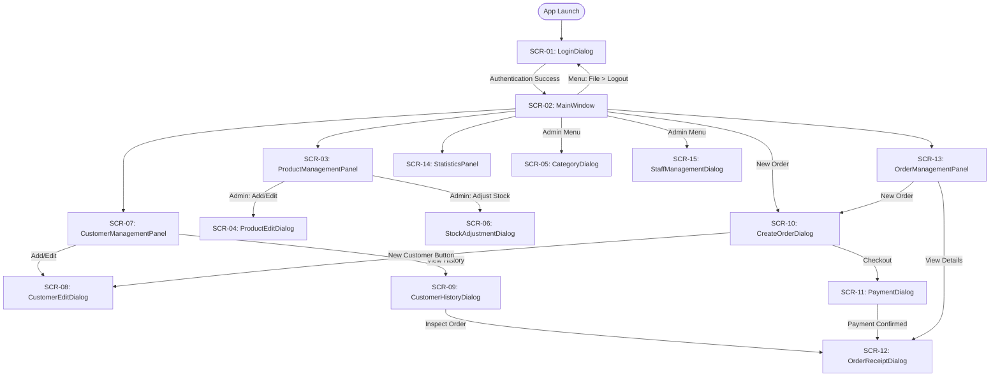

# Screen List & UI Architecture: Online Sales Management

## Document Metadata

- **Tier:** UI/UX Tier (`UI/UX/`)
- **Owner:** Member C ([Member C Name])
- **Associated Requirements:** `Controller/docs/requirements.md` (Section 5)
- **Framework:** Java Swing (JDK 21), Desktop GUI

---

## 1. Master Screen Catalog

The following table defines the complete list of screens, dialogs, and panels that compose the Online Sales Management application.

| Screen ID | Screen / Component Name | Swing Class Type | Purpose & Core Capabilities | Opened From | Allowed Roles |
|---|---|---|---|---|---|
| `SCR-01` | `LoginDialog` | `JDialog` (Modal) | Staff credential entry (`username`, masked `password`). Connects to database, authenticates, and initializes user session. | Application Startup (`App.main`) / Re-opened upon Logout | All (`ADMIN`, `SALES_STAFF`) |
| `SCR-02` | `MainWindow` | `JFrame` (Main Window) | Master container holding top menu bar, navigation tabs, user session info header, and bottom status bar. | `LoginDialog` (on successful authentication) | All (`ADMIN`, `SALES_STAFF` with role-based tab masking) |
| `SCR-03` | `ProductManagementPanel` | `JPanel` (Tab in `MainWindow`) | Browse product catalog with search bar, category filter, price filter, stock counters, product table. Admin sees "Add Product", "Edit", "Adjust Stock", "Deactivate". | `MainWindow` ("Products" Tab) | All (Staff: view/search; Admin: full CRUD) |
| `SCR-04` | `ProductEditDialog` | `JDialog` (Modal) | Form to create a new product or modify an existing product (name, category dropdown, price in VND, description). | `ProductManagementPanel` ("Add" or "Edit" button) | `ADMIN` only |
| `SCR-05` | `CategoryDialog` | `JDialog` (Modal) | Manage product categories (list, create new, edit name/description, deactivate). | `MainWindow` (Menu: Management $\rightarrow$ Categories) | `ADMIN` only |
| `SCR-06` | `StockAdjustmentDialog` | `JDialog` (Modal) | Quick adjustment of inventory units (delta addition/subtraction with audit note). | `ProductManagementPanel` ("Adjust Stock" button) | `ADMIN` only |
| `SCR-07` | `CustomerManagementPanel` | `JPanel` (Tab in `MainWindow`) | Customer directory table, search by name/phone/email, button to register new customer, edit details, or view order history. | `MainWindow` ("Customers" Tab) | All (`ADMIN`, `SALES_STAFF`) |
| `SCR-08` | `CustomerEditDialog` | `JDialog` (Modal) | Form to register a new customer or update existing details (name, phone, email, delivery address). | `CustomerManagementPanel` OR `CreateOrderDialog` ("+ New" button) | All (`ADMIN`, `SALES_STAFF`) |
| `SCR-09` | `CustomerHistoryDialog` | `JDialog` (Modal) | Displays order history table for a selected customer with date, order total, status, and view receipt action. | `CustomerManagementPanel` ("View History" button) | All (`ADMIN`, `SALES_STAFF`) |
| `SCR-10` | `CreateOrderDialog` | `JDialog` (Modal/Full) | Point-of-sale checkout workspace: customer selector, product search & add-to-cart, cart table with quantity spinners, subtotal/discount calculations, and checkout trigger. | `MainWindow` ("New Order" button in header or Orders tab) | All (`ADMIN`, `SALES_STAFF`) |
| `SCR-11` | `PaymentDialog` | `JDialog` (Modal) | Polymorphic payment collector: select Cash (enter given money, calculate change) or Card/Transfer (enter bank trace ref, cardholder name). | `CreateOrderDialog` ("Proceed to Payment" button) | All (`ADMIN`, `SALES_STAFF`) |
| `SCR-12` | `OrderReceiptDialog` | `JDialog` (Modal) | Visual receipt invoice displaying order code, customer info, clerk name, itemized table, payment method, and formatted VND totals. | `CreateOrderDialog` (post-checkout) OR `OrderManagementPanel` ("View Details") | All (`ADMIN`, `SALES_STAFF`) |
| `SCR-13` | `OrderManagementPanel` | `JPanel` (Tab in `MainWindow`) | Browse order queue, multi-filter by status, date range, customer name/code. Context actions: view detail receipt, advance status (`PAID` $\rightarrow$ `SHIPPED`), cancel order. | `MainWindow` ("Orders" Tab) | All (`ADMIN`, `SALES_STAFF`) |
| `SCR-14` | `StatisticsPanel` | `JPanel` (Tab in `MainWindow`) | Analytical dashboard with three sub-views: (1) Daily Revenue Summary table & totals, (2) Top 10 Selling Products leaderboard, (3) Low-Stock Alerts table. | `MainWindow` ("Statistics" Tab) | Revenue/Top: `ADMIN` only; Low-Stock: All |
| `SCR-15` | `StaffManagementDialog` | `JDialog` (Modal) | Manage employee user accounts: list staff, register new employee, assign `Role` (`ADMIN` or `SALES_STAFF`), toggle active status, reset password. | `MainWindow` (Menu: Management $\rightarrow$ Staff Accounts) | `ADMIN` only |

---

## 2. Navigation & Screen Flow Diagram

---

## 3. UI/UX General Design Conventions

1. **Currency Display Formatting:**
   - All monetary values must be formatted as VND with no decimals: `#,##0 VND` (e.g. `150,000 VND`).
   - Right-align money columns in all `JTable` views.
2. **Date and Time Formatting:**
   - Dates: `dd/MM/yyyy` (e.g. `20/10/2026`).
   - Timestamps: `dd/MM/yyyy HH:mm:ss`.
3. **Role-Based Widget Enabling:**
   - If user is `SALES_STAFF`, hide or disable Admin-only menu items (`Staff Accounts`, `Categories`), hide financial sub-tabs in `StatisticsPanel` (Daily Revenue, Top Products), and disable product modification buttons.
4. **Data Grid Standard:**
   - Read-only table cells (non-editable `DefaultTableModel`).
   - Alternating row striping and single-row selection mode (`ListSelectionModel.SINGLE_SELECTION`).
5. **Notice for UI Developer (`ui-dev`):**
   - Detailed button actions, layouts, field lengths, and component hierarchies will be expanded in this file during GUI design iterations.
