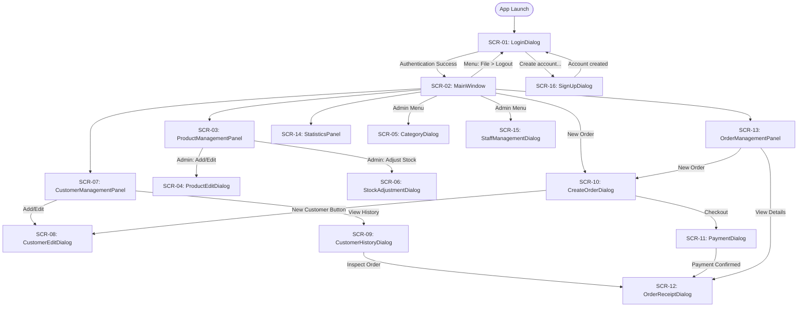

# Screen List & UI Architecture: Online Sales Management

## Document Metadata

- **Tier:** UI/UX Tier (`UI/UX/`)
- **Owner:** Member C ([Member C Name])
- **Associated Requirements:** `Controller/docs/requirements.md` (Section 5)
- **Framework:** Java Swing (JDK 21), Desktop GUI

---

## 1. Master Screen Catalog

The following table defines the complete list of screens, dialogs, and panels that compose the Online Sales Management application.

| Screen ID | Screen / Component Name | Swing Class Type | Purpose & Core Capabilities | Opened From | Allowed Roles |
|---|---|---|---|---|---|
| `SCR-01` | `LoginDialog` | `JDialog` (Modal) | Staff credential entry (`username`, masked `password`). Connects to database, authenticates, and initializes user session. | Application Startup (`App.main`) / Re-opened upon Logout | All (`ADMIN`, `SALES_STAFF`) |
| `SCR-02` | `MainWindow` | `JFrame` (Main Window) | Master container holding top menu bar, navigation tabs, user session info header, and bottom status bar. | `LoginDialog` (on successful authentication) | All (`ADMIN`, `SALES_STAFF` with role-based tab masking) |
| `SCR-03` | `ProductManagementPanel` | `JPanel` (Tab in `MainWindow`) | Browse product catalog with search bar, category filter, price filter, stock counters, product table. Admin sees "Add Product", "Edit", "Adjust Stock", "Deactivate". | `MainWindow` ("Products" Tab) | All (Staff: view/search; Admin: full CRUD) |
| `SCR-04` | `ProductEditDialog` | `JDialog` (Modal) | Form to create a new product or modify an existing product (name, category dropdown, price in VND, description). | `ProductManagementPanel` ("Add" or "Edit" button) | `ADMIN` only |
| `SCR-05` | `CategoryDialog` | `JDialog` (Modal) | Manage product categories (list, create new, edit name/description, deactivate). | `MainWindow` (Menu: Management $\rightarrow$ Categories) | `ADMIN` only |
| `SCR-06` | `StockAdjustmentDialog` | `JDialog` (Modal) | Quick adjustment of inventory units (delta addition/subtraction with audit note). | `ProductManagementPanel` ("Adjust Stock" button) | `ADMIN` only |
| `SCR-07` | `CustomerManagementPanel` | `JPanel` (Tab in `MainWindow`) | Customer directory table, search by name/phone/email, button to register new customer, edit details, or view order history. | `MainWindow` ("Customers" Tab) | All (`ADMIN`, `SALES_STAFF`) |
| `SCR-08` | `CustomerEditDialog` | `JDialog` (Modal) | Form to register a new customer or update existing details (name, phone, email, delivery address). | `CustomerManagementPanel` OR `CreateOrderDialog` ("+ New" button) | All (`ADMIN`, `SALES_STAFF`) |
| `SCR-09` | `CustomerHistoryDialog` | `JDialog` (Modal) | Displays order history table for a selected customer with date, order total, status, and view receipt action. | `CustomerManagementPanel` ("View History" button) | All (`ADMIN`, `SALES_STAFF`) |
| `SCR-10` | `CreateOrderDialog` | `JDialog` (Modal/Full) | Point-of-sale checkout workspace: customer selector, product search & add-to-cart, cart table with quantity spinners, subtotal/discount calculations, and checkout trigger. | `MainWindow` ("New Order" button in header or Orders tab) | All (`ADMIN`, `SALES_STAFF`) |
| `SCR-11` | `PaymentDialog` | `JDialog` (Modal) | Polymorphic payment collector: select Cash (enter given money, calculate change) or Card/Transfer (enter bank trace ref, cardholder name). | `CreateOrderDialog` ("Proceed to Payment" button) | All (`ADMIN`, `SALES_STAFF`) |
| `SCR-12` | `OrderReceiptDialog` | `JDialog` (Modal) | Visual receipt invoice displaying order code, customer info, clerk name, itemized table, payment method, and formatted VND totals. | `CreateOrderDialog` (post-checkout) OR `OrderManagementPanel` ("View Details") | All (`ADMIN`, `SALES_STAFF`) |
| `SCR-13` | `OrderManagementPanel` | `JPanel` (Tab in `MainWindow`) | Browse order queue, multi-filter by status, date range, customer name/code. Context actions: view detail receipt, advance status (`PAID` $\rightarrow$ `SHIPPED`), cancel order. | `MainWindow` ("Orders" Tab) | All (`ADMIN`, `SALES_STAFF`) |
| `SCR-14` | `StatisticsPanel` | `JPanel` (Tab in `MainWindow`) | Analytical dashboard with three sub-views: (1) Daily Revenue Summary table & totals, (2) Top 10 Selling Products leaderboard, (3) Low-Stock Alerts table. | `MainWindow` ("Statistics" Tab) | Revenue/Top: `ADMIN` only; Low-Stock: All |
| `SCR-15` | `StaffManagementDialog` | `JDialog` (Modal) | Manage employee user accounts: list staff, register new employee, assign `Role` (`ADMIN` or `SALES_STAFF`), toggle active status, reset password. | `MainWindow` (Menu: Management $\rightarrow$ Staff Accounts) | `ADMIN` only |
| `SCR-16` | `SignUpDialog` | `JDialog` (Modal) | Self sign-up: username, full name, email, phone, password + confirmation. New accounts are always `SALES_STAFF` and active. | `LoginDialog` ("Create account..." button) | Anyone at the login screen |

---

## 2. Navigation & Screen Flow Diagram

---

## 3. UI/UX General Design Conventions

1. **Currency Display Formatting:**
   - All monetary values must be formatted as VND with no decimals: `#,##0 VND` (e.g. `150,000 VND`).
   - Right-align money columns in all `JTable` views.
2. **Date and Time Formatting:**
   - Dates: `dd/MM/yyyy` (e.g. `20/10/2026`).
   - Timestamps: `dd/MM/yyyy HH:mm:ss`.
3. **Role-Based Widget Enabling:**
   - If user is `SALES_STAFF`, hide or disable Admin-only menu items (`Staff Accounts`, `Categories`), hide financial sub-tabs in `StatisticsPanel` (Daily Revenue, Top Products), and disable product modification buttons.
4. **Data Grid Standard:**
   - Read-only table cells (non-editable `DefaultTableModel`).
   - Alternating row striping and single-row selection mode (`ListSelectionModel.SINGLE_SELECTION`).
5. **Notice for UI Developer (`ui-dev`):**
   - Detailed button actions, layouts, field lengths, and component hierarchies will be expanded in this file during GUI design iterations.

---

## 4. Built in S1 (skeleton)

### 4.1 Shared UI components
| Class | Kind | Purpose | OOP point for the report |
|---|---|---|---|
| `UiFormat` | final utility class | VND money, `dd/MM/yyyy` dates, `dd/MM/yyyy HH:mm:ss` timestamps | private constructor; static methods |
| `ReadOnlyTableModel<T>` | abstract generic class, extends `AbstractTableModel` | base model of every screen table; cells never editable | abstract class with abstract `columnNames()`/`valueOf()` and concrete `setRows()`/`getRowAt()`; overriding `isCellEditable` |
| `StripedTable` | class, extends `JTable` | zebra rows, single selection, sortable columns | inheritance; overriding `prepareRenderer` |

Note for every screen: `StripedTable` sorts rows, so convert the selected view row with `table.convertRowIndexToModel(row)`
before calling `model.getRowAt(...)`.

### 4.2 SCR-02 MainWindow (S1 state)
| Component | Type | What happens | Service call (from slice) |
|---|---|---|---|
| `lblSession` | `JLabel` | Displays current staff user and role or "Not signed in" | none yet (S2 `AuthService.login()` via `showSession`) |
| `lblStatus` | `JLabel` | Displays status bar message (default "Ready") | none yet (UI status updates) |
| `btnNewOrder` | `JButton` | Disabled in S1, tooltip "Checkout arrives in slice S5" | none yet (S5 opens `CreateOrderDialog`; checkout calls `OrderService.checkout(Order)`) |
| `tabs` | `JTabbedPane` | Container for primary module panels (Products, Customers, Orders, Statistics) | none yet (S3 `CatalogService`, S4 `CustomerService`, S6 `OrderService`, S7 `ReportService`) |
| `mnuLogout` | `JMenuItem` | Triggers logout action to clear session and return to login dialog | none yet (S2 `AuthService.logout()`) |
| `mnuExit` | `JMenuItem` | Closes and exits the application | none yet (none / exits application) |
| `mnuCategories` | `JMenuItem` | In S1 shows placeholder popup; S3 opens category management dialog (Admin only) | none yet (S3 opens `CategoryDialog`, `CatalogService.getAllCategories()`) |
| `mnuStaff` | `JMenuItem` | In S1 shows placeholder popup; S2 opens staff account management dialog (Admin only) | none yet (S2 opens `StaffManagementDialog`, `StaffService.createStaff(...)` / `updateStaff(...)` / `deactivateStaff(...)`) |

### 4.3 SCR-01 LoginDialog (S1 state)
| Component | Type | What happens | Service call (from slice) |
|---|---|---|---|
| `txtUsername` | `JTextField` | Captures staff username input | none yet (S2 passed to `AuthService.login(username, password)`) |
| `pwdPassword` | `JPasswordField` | Captures staff password input (masked) | none yet (S2 passed to `AuthService.login(username, password)`) |
| `btnLogin` | `JButton` | Validates fields non-blank; closes dialog on success or shows error | none yet (S2 `AuthService.login(username, password)`) |
| `btnCancel` | `JButton` | Cancels login and closes dialog without authenticating | none yet (none / dismisses dialog) |
| `lblError` | `JLabel` | Displays validation or authentication error message in red text | none yet (none / displays error message from service exception) |

In S1 the password is not checked. From S2, `btnLogin` calls `AuthService.login(username, password)` and passes the
returned `Staff` to `MainWindow.showSession(...)`.

---

## 5. Built in S2 (login, logout, sign-up)

### 5.1 SCR-01 LoginDialog (S2 state)

| Component | Type | What happens | Service call |
|---|---|---|---|
| `txtUsername` | `JTextField` | Captures staff username input | Passed to `AuthService.login(username, password)` |
| `pwdPassword` | `JPasswordField` | Captures staff password input (masked; cleared immediately after use) | Passed to `AuthService.login(username, password)` |
| `btnLogin` | `JButton` | Validates inputs are not blank; calls `AuthService.login(username, password)`; on success MainWindow shows the Staff; on failure displays error in `lblError` | `AuthService.login(username, password)` |
| `btnSignUp` | `JButton` | Opens SCR-16 (`SignUpDialog`); on success pre-fills the username, clears password, and shows green confirmation info | none (opens `SignUpDialog`) |
| `btnCancel` | `JButton` | Closes the app (exits application via `System.exit(0)`) | none |
| `lblError` | `JLabel` | Displays red errors on failure, or green "Account created. Sign in with your new password." info | none |

### 5.2 SCR-16 SignUpDialog

| Component | Type | What happens | Service call |
|---|---|---|---|
| `txtUsername` | `JTextField` | Captures desired staff username | Passed to `AuthService.signUp(...)` |
| `txtFullName` | `JTextField` | Captures staff member full name | Passed to `AuthService.signUp(...)` |
| `txtEmail` | `JTextField` | Captures staff email address | Passed to `AuthService.signUp(...)` |
| `txtPhone` | `JTextField` | Captures 10-digit phone number starting with 0 | Passed to `AuthService.signUp(...)` |
| `pwdPassword` | `JPasswordField` | Captures initial password (minimum 8 chars, letter + digit) | Passed to `AuthService.signUp(...)` |
| `pwdConfirm` | `JPasswordField` | Captures password confirmation to verify match | Checked locally before service call |
| `lblInfo` | `JLabel` | Displays informational notice: "New accounts get the Sales Staff role." | none |
| `lblError` | `JLabel` | Displays validation or database error messages in red text | none |
| `btnCreate` | `JButton` | Checks the two passwords match first; calls `AuthService.signUp(username, password, fullName, email, phone)`; on success retains created Staff and disposes dialog; on failure displays error | `AuthService.signUp(username, password, fullName, email, phone)` |
| `btnCancel` | `JButton` | Cancels registration, clears password fields, and closes the dialog | none |

### 5.3 Error messages

Listing of error message texts from the slice contract and which screen displays each:

| Error Message Text | Screen | Trigger Condition |
|---|---|---|
| `Enter your username and password.` | `SCR-01 LoginDialog` | Username is blank or password is empty |
| `Wrong username or password.` | `SCR-01 LoginDialog` | Staff username not found or password hash does not match |
| `Account has been deactivated. Please contact the administrator.` | `SCR-01 LoginDialog` | Staff account exists but is deactivated (`active == false`) |
| `Passwords do not match.` | `SCR-16 SignUpDialog` | `pwdPassword` and `pwdConfirm` inputs do not match |
| `Full name must be 2 to 100 characters.` | `SCR-16 SignUpDialog` | Full name length outside 2–100 characters when trimmed |
| `Enter a valid email address.` | `SCR-16 SignUpDialog` | Email format invalid or exceeds 100 characters |
| `Phone must be 10 digits starting with 0.` | `SCR-16 SignUpDialog` | Phone number format does not match `^0\d{9}$` |
| `Username must be 3 to 50 letters, digits, dots or underscores.` | `SCR-16 SignUpDialog` | Username format does not match `^[a-z0-9._]{3,50}$` |
| `Password must be at least 8 characters with a letter and a digit.` | `SCR-16 SignUpDialog` | Password shorter than 8 characters or lacks letter/digit |
| `Username is already taken.` | `SCR-16 SignUpDialog` | Staff username is already present in the database |
| `Cannot reach the database: ` + message | `SCR-01 LoginDialog`, `SCR-16 SignUpDialog` | Database connectivity failure or unexpected `RuntimeException` |

Logout (File > Logout) calls `AuthService.logout()` and re-opens SCR-01.

